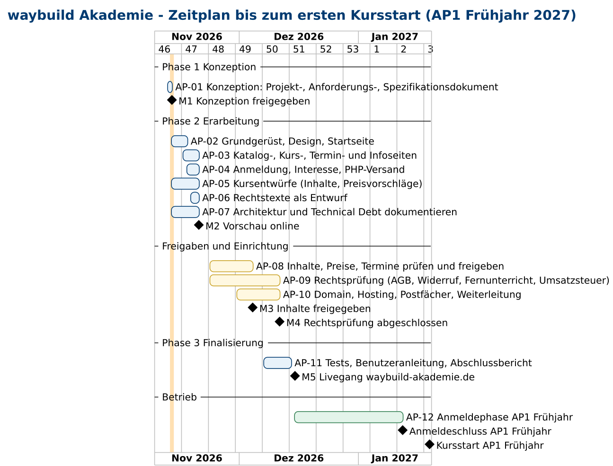

# Projektdokumentation waybuild Akademie

Phase 1 „Konzeption“ · Stand: 13.11.2026 · Status: **Entwurf zur Freigabe**

Dieses Dokument beschreibt das Projekt „Website der waybuild Akademie“ als Ganzes: Ziel, Nutzen, Umfang, Beteiligte,
Risiken und Zeitplan. Was die Website im Einzelnen können muss, steht im [Anforderungsdokument](02-anforderungen.md)
(User Stories **US-xx**, nichtfunktionale Anforderungen **NFA-xx**). Wie Daten, Abläufe und Seiten aussehen, steht in der
[Spezifikation](03-spezifikation.md); die Technik in der [Architektur](04-architektur.md).

---

## Inhalt

1. [Projektübersicht](#1-projektübersicht)
2. [Beteiligte und Rollen](#2-beteiligte-und-rollen)
3. [Risikomanagement](#3-risikomanagement)
4. [Zeitplan](#4-zeitplan)
5. [Freigabe](#5-freigabe)

---

## 1. Projektübersicht

### 1.1 Ziel

Die waybuild Akademie bekommt eine eigene, schnelle und seriöse Website unter **waybuild-akademie.de**, über die
Interessenten Live-Online-Kurse finden, vergleichen und sich verbindlich anmelden können. Erstes Geschäftsziel ist,
dass Anmeldungen für den ersten Kursdurchgang **„Vorbereitung auf die IHK-Prüfung AP1 – IT-Berufe“ (Frühjahr 2027)**
rechtzeitig vor dem Anmeldeschluss am **12.01.2027** eingehen können.

Messbare Projektziele:

| Ziel | Messgröße | Bezug |
|---|---|---|
| Website live vor Anmeldestart | Livegang spätestens 15.12.2026 (M5) | Zeitplan, Abschnitt 4 |
| Alle Muss-Anforderungen erfüllt | 20 von 20 Muss-Stories abgenommen | US-01 … US-29 (Muss) |
| Schnell und barrierearm | Lighthouse mobil ≥ 95, WCAG 2.2 AA | NFA-01 … NFA-04 |
| Datensparsam | keine Tracker, keine Fremd-Domains | NFA-08, NFA-09 |
| Pflegbar ohne Programmierung | neuer Kurs in < 30 Minuten | US-21, NFA-18 |

### 1.2 Kundennutzen

- **Für Azubis, Umschüler und Berufstätige:** Sie sehen in Sekunden, was sie bekommen, was es kostet, wann es stattfindet
  und wie sie starten – Preis, Umfang und nächster Termin stehen schon auf der Kurskarte (US-01, US-03, US-07).
- **Für Ausbildungsbetriebe:** Sie finden alle Angaben für eine Kostenübernahme, melden bis zu fünf Personen in einem
  Vorgang an und erhalten die Rechnung an die Firma (US-11, US-13).
- **Für alle:** Anmeldung ohne Kundenkonto und ohne Online-Zahlung; die Rechnung kommt per E-Mail (US-10, US-12).
- **Für das Team:** Kurse, Termine und Preise stehen in einfachen Inhaltsdateien; neue Kursideen erscheinen erst nach
  Freigabe öffentlich (US-21 … US-23). Anmeldungen kommen einheitlich aufgebaut im Postfach an (US-24).

### 1.3 Umfang (erster Release)

| Bereich | Enthalten |
|---|---|
| Angebot | Drei Säulen: IHK-Prüfungsvorbereitung, IHK-Weiterbildungen (berufsbegleitend), eigene Weiterbildungen (KI, Programmierung, IT). Zum Start freigegeben: AP1 alle IT-Berufe, AP2 Fachinformatik Systemintegration, Prüfungscoaching; weitere Kurse zunächst als Entwurf. |
| Seiten | Start, Kurskatalog mit Filter, Kursdetailseiten, Terminübersicht, Landingpage Prüfungsvorbereitung, Coaching, Über uns, FAQ, Kontakt, Anmeldung, Interesse vormerken, Danke, Rechtsseiten, Fehlerseite 404 |
| Formulare | Anmeldung, Interesse vormerken, Coaching-Anfrage, Kontakt – Versand per E-Mail mit Eingangsbestätigung |
| Pflege | Inhaltsdatei je Kurs mit automatischer Prüfung; Vorschau mit Entwürfen |
| Betrieb | Live auf ALL-INKL-Webspace, Vorschau auf GitHub Pages, Weiterleitung top-abschluss.de |
| Dokumentation | Dokumente 01–08 nach [Entwicklungsprozess](00-prozess.md) |

### 1.4 Abgrenzung (nicht im Umfang)

Ausdrücklich nicht enthalten sind Online-Zahlung, Nutzerkonten, Dozentenprofile, Präsenzkurse, eine Lernplattform,
Blog und KI-Chat sowie Förderhinweise ohne Freigabe. Die vollständige Liste mit Gründen steht im
Anforderungsdokument, [Abschnitt 3.4](02-anforderungen.md#34-bewusst-nicht-im-umfang).
Außerhalb der Website laufen außerdem: Rechnungsstellung und Zahlungsüberwachung (Backoffice), der Live-Raum
(Videokonferenz) sowie Verträge mit Lehrenden.

---

## 2. Beteiligte und Rollen

Die Beteiligten werden als **Rollen** geführt (eine Person kann mehrere Rollen haben). Die Ziele der Stakeholder stehen im
[Anforderungsdokument, Abschnitt 2](02-anforderungen.md#2-stakeholder).

| Rolle | Aufgabe im Projekt | Entscheidet über |
|---|---|---|
| **Auftraggeber / Geschäftsführung** | Gibt Umfang, Inhalte, Preise und Texte frei; nimmt Phasen ab | Gates, Kursfreigaben, Preise, Livegang |
| **Projektleitung** | Plant Arbeitspakete, hält Zeitplan und Risiken aktuell, berichtet | Reihenfolge der Arbeit |
| **Entwicklung** | Baut Website, Formular-Endpunkt, Tests und Bereitstellung | technische Umsetzung im Rahmen der Architektur |
| **Redaktion** (Team, KI-Assistent für Kursentwürfe) | Schreibt und pflegt Kurse, Termine, FAQ; legt Entwürfe an | Inhalte bis zur Freigabe |
| **Backoffice** | Bearbeitet Anmeldungen, stellt Rechnungen, versendet Zugangsdaten | Rückfragen an Teilnehmende |
| **Fachliche Prüfung** (Lehrende mit IHK-Prüfungserfahrung) | Prüft Kursinhalte und Prüfungsbezug | fachliche Richtigkeit |
| **Rechtsberatung** (extern) | Prüft Rechtstexte, Formular, Fernunterrichtsfrage | rechtliche Freigabe der Texte |
| **Steuerberatung** (extern) | Klärt umsatzsteuerliche Behandlung | Preisangabe mit/ohne Umsatzsteuer |
| **Hosting-Verwaltung** | Richtet Domain, Postfächer, Weiterleitung, Zertifikat ein | Konfiguration ALL-INKL |

---

## 3. Risikomanagement

**Bewertung:** Eintrittswahrscheinlichkeit (W) und Schwere (S) je **niedrig / mittel / hoch**.
Risiken mit hoher Schwere werden vor dem Livegang (M5) entschieden oder ausdrücklich in Kauf genommen.
Die Liste wird bei jedem Meilenstein überprüft. Rechtliche Punkte sind hier bewusst neutral als „zu prüfen“ formuliert;
sie sind keine Rechtsberatung.

| ID | Risiko | W | S | Gegenmaßnahme | Verantwortlich |
|---|---|---|---|---|---|
| R-01 | **Fernunterrichtsschutzgesetz (FernUSG):** Nach einem Urteil des Bundesgerichtshofs vom 12.06.2025 (III ZR 109/24) können auch Live-Online-Kurse mit einer Überwachung des Lernerfolgs als Fernunterricht gelten. Dann wäre eine Zulassung der Staatlichen Zentralstelle für Fernunterricht (ZFU) nötig; ohne Zulassung drohen unwirksame Verträge und Rückforderungen. | mittel | hoch | Für unser Kursformat **rechtlich prüfen lassen** (AP-09, vor M4). Je nach Ergebnis: ZFU-Zulassung beantragen oder Kursgestaltung und Texte anpassen. Bis zur Klärung keine Aussagen, die über das tatsächliche Format hinausgehen. | Geschäftsführung mit Rechtsberatung |
| R-02 | **Widerrufsrecht und Button-Lösung:** Fehlerhafte Widerrufsbelehrung, fehlendes Muster-Formular oder ein unklar beschrifteter Absende-Knopf können Verträge angreifbar machen bzw. die Widerrufsfrist verlängern. | mittel | hoch | Absende-Knopf „Zahlungspflichtig anmelden“ (GR-14), Widerrufsbelehrung mit Muster-Formular (US-20), Regelung zum Kursbeginn vor Fristende rechtlich prüfen; Texte bis zur Prüfung als Entwurf nur in der Vorschau. | Rechtsberatung, Entwicklung |
| R-03 | **Umsatzsteuer auf Bildungsleistungen:** Ob die Kurse umsatzsteuerfrei sind, ist nicht geklärt. Falsche Angaben („umsatzsteuerfrei“) oder eine spätere Steuerpflicht würden Preise bzw. Marge verändern. | mittel | mittel | Steuerliche Klärung (AP-09). Bis dahin Preise als Endpreise ohne Steuerhinweis „umsatzsteuerfrei“ (GR-12); Kalkulation berücksichtigt beide Fälle. Siehe [Technical Debt TD-02](05-technical-debt.md). | Geschäftsführung mit Steuerberatung |
| R-04 | **Irreführung / IHK-Bezug:** Formulierungen, die eine Trägerschaft, Partnerschaft oder Zertifizierung durch die IHK nahelegen, sind wettbewerbsrechtlich riskant. | mittel | hoch | Pflichthinweis „Unabhängiges Bildungsangebot – keine Veranstaltung der IHK“ (US-19, GR-13), Begriffsliste und Textprüfung vor jeder Freigabe (NFA-20, NFA-22), keine IHK-Logos. | Redaktion, Geschäftsführung |
| R-05 | **Scheinselbständigkeit der Lehrenden:** Eine Darstellung der Lehrenden als festes, eingegliedertes Team kann ein Indiz für abhängige Beschäftigung sein. | niedrig | mittel | Lehrende werden nur allgemein beschrieben, ohne Namen, Fotos oder Lebensläufe (US-18, GR-15). Vertragsgestaltung außerhalb der Website prüfen. | Geschäftsführung |
| R-06 | **Inhalte noch Entwurf:** Viele Kursbeschreibungen, Dauern und Preise sind Vorschläge. Ungeprüfte Angaben könnten öffentlich erscheinen oder fachlich falsch sein. | hoch | mittel | Status „Entwurf“ als Standard, Entwürfe nur in der Vorschau (US-22, GR-10), automatischer Test, dass der Live-Build keine Entwürfe enthält (NFA-19), Freigabe je Kurs (US-23). | Redaktion, Geschäftsführung |
| R-07 | **Formular-Spam:** Automatisierte Eingaben füllen das Postfach und verdecken echte Anmeldungen. | hoch | niedrig | Lockfeld, Zeitfalle, Begrenzung je Zeitraum, serverseitige Prüfung (NFA-13, NFA-14); Spam-Quote im ersten Monat beobachten, bei Bedarf nachschärfen. | Entwicklung |
| R-08 | **Domain und Hosting ALL-INKL:** Domain, Postfächer oder Weiterleitung sind nicht rechtzeitig eingerichtet; Mails aus dem Formular landen im Spam (fehlende Absender-Authentifizierung). | mittel | hoch | Einrichtung als eigenes Arbeitspaket mit Puffer (AP-10); SPF, DKIM und DMARC für die Domain; Testanmeldungen an verschiedene Postfächer vor M5; Vorschau bleibt unabhängig auf GitHub Pages. | Hosting-Verwaltung, Entwicklung |
| R-09 | **IHK-Termine verschieben sich** oder unterscheiden sich je IHK; Kurse enden dann zu früh oder zu spät. | mittel | mittel | Termine vor Freigabe mit der zuständigen IHK abgleichen; Hinweis „verbindlich ist die Einladung deiner IHK“ (US-28); Termine zentral in der Inhaltsdatei änderbar (US-21). | Redaktion |
| R-10 | **Datenschutz im Formular:** Unvollständige Informationen nach DSGVO, zu viele Pflichtfelder oder unklare Speicherdauer im Postfach. | mittel | mittel | Datensparsame Pflichtfelder (NFA-10), Zweck am Formular erklärt, keine Datenbank, Übertragung nur per HTTPS (NFA-11), Lösch- und Aufbewahrungsregeln in der Datenschutzerklärung; Prüfung mit den Rechtstexten (AP-09). | Rechtsberatung, Backoffice |
| R-11 | **Zeitplan zu knapp** für den ersten Durchgang AP1 Frühjahr (Anmeldeschluss 12.01.2027). | mittel | hoch | Livegang mit allen Muss-Anforderungen, Soll-Punkte dürfen nachfolgen; Freigaben (M3, M4) parallel statt nacheinander; Ausweichplan: Start mit AP2 Sommer 2027 bzw. AP1 Herbst 2027. | Projektleitung |
| R-12 | **Zu wenige Anmeldungen**, Kurs kann nicht wirtschaftlich stattfinden. | mittel | mittel | Absage durch uns bis 10 Tage vor Start mit Erstattung oder Wechsel (GR-08); Mindestteilnehmerzahl nicht öffentlich; „Interesse vormerken“ zeigt Nachfrage früh (US-14). | Geschäftsführung |
| R-13 | **Coaching wird als unzulässige Hilfe bei Prüfungsleistungen missverstanden.** | niedrig | mittel | Klarer Hinweis auf Coaching-Seite und im Formular: Prüfungsleistungen erstellen die Teilnehmenden selbst, keine Einflussnahme auf Prüfung oder Bewertung (US-15, US-19). | Redaktion |
| R-14 | **Barrierefreiheit nicht ausreichend** (Pflicht nach BFSG). | niedrig | mittel | Barrierearme Bausteine, automatische Prüfung je Seitentyp, Tastatur- und Screenreader-Test (NFA-03, NFA-04); Erklärung zur Barrierefreiheit. | Entwicklung |

**Summe:** 14 Risiken, davon 5 mit hoher Schwere (R-01, R-02, R-04, R-08, R-11). Die Risiken R-01 bis R-03 und R-10
werden im Arbeitspaket AP-09 gemeinsam geprüft. Offene Punkte, die bewusst erst nach dem Livegang gelöst werden, stehen
im [Technical-Debt-Dokument](05-technical-debt.md).

---

## 4. Zeitplan

### 4.1 Meilensteine

| ID | Meilenstein | Termin | Ergebnis / Abnahmekriterium |
|---|---|---|---|
| **M1** | Konzeption freigegeben | 13.11.2026 | Dokumente 01–03 liegen vor; Freigabe von Inhalt und Umfang durch die Geschäftsführung (Gate Phase 1) |
| **M2** | Vorschau online | 20.11.2026 | Alle Seiten und Formulare in der Vorschau (GitHub Pages), Entwürfe gekennzeichnet; Dokumente 04 und 05 liegen vor (Gate Phase 2) |
| **M3** | Inhalte freigegeben | 04.12.2026 | Startkurse, Preise, Termine und Texte von der Geschäftsführung freigegeben (US-23) |
| **M4** | Rechtsprüfung abgeschlossen | 11.12.2026 | Rechtstexte, Formular und Fernunterrichtsfrage geprüft; Umsatzsteuerfrage entschieden oder als Risiko angenommen |
| **M5** | Livegang | 15.12.2026 | waybuild-akademie.de live mit allen Muss-Anforderungen; Testprotokoll ohne offene kritische Fehler (Gate Phase 3) |
| – | Anmeldeschluss AP1 Frühjahr | 12.01.2027 | Start − 7 Tage (GR-01) |
| – | Kursstart AP1 Frühjahr | 19.01.2027 | erster Kurstag |

### 4.2 Arbeitspakete

| ID | Arbeitspaket | Zeitraum | Ergebnis | Meilenstein |
|---|---|---|---|---|
| AP-01 | Konzeption: Projekt-, Anforderungs-, Spezifikationsdokument | 12.–13.11.2026 | Dokumente 01–03, Use-Case-Diagramm | M1 |
| AP-02 | Grundgerüst, Design-System, Layout, Startseite, Bereitstellung | 13.–17.11.2026 | Startseite in der Vorschau | M2 |
| AP-03 | Katalog, Kursdetail, Termine, Prüfungsvorbereitung, Coaching, FAQ, Über uns, Kontakt | 16.–20.11.2026 | alle Informationsseiten | M2 |
| AP-04 | Anmeldung, Interesse, Danke, PHP-Versand, Tests | 17.–20.11.2026 | funktionsfähige Formulare (Vorschau im Demo-Modus) | M2 |
| AP-05 | Kursentwürfe (Inhalte, Dauer, Preisvorschläge) | 13.–20.11.2026 | weitere Kurse als Entwurf | M2 |
| AP-06 | Rechtstexte als Entwurf (Impressum, Datenschutz, Teilnahmebedingungen, Widerruf) | 18.–20.11.2026 | gekennzeichnete Entwürfe | M2 |
| AP-07 | Architektur und Technical Debt dokumentieren | 13.–20.11.2026 | Dokumente 04 und 05 | M2 |
| AP-08 | Inhalte, Preise, Termine prüfen und freigeben | 23.11.–04.12.2026 | freigegebene Startkurse | M3 |
| AP-09 | Rechtsprüfung (Teilnahmebedingungen, Widerruf, Fernunterricht, Umsatzsteuer, Datenschutz) | 23.11.–11.12.2026 | geprüfte Texte, Entscheidungen zu R-01 … R-03 | M4 |
| AP-10 | Domain, Hosting, Postfächer, Weiterleitung, Zertifikat | 30.11.–11.12.2026 | Live-Umgebung bereit, Testmails zugestellt | M5 |
| AP-11 | Tests, Benutzeranleitung, Abschlussbericht | 07.–14.12.2026 | Dokumente 06–08, Testprotokoll | M5 |
| AP-12 | Anmeldephase AP1 Frühjahr (Betrieb) | 15.12.2026–12.01.2027 | eingehende Anmeldungen bearbeitet | – |

### 4.3 Gantt-Diagramm

Balken = Arbeitspakete, Rauten = Meilensteine. Blau: Entwicklung und Dokumentation, Gelb: Freigaben und Einrichtung,
Grün: Betrieb. Die orange Linie markiert den Stand (13.11.2026).

Quelltext: [`diagramme/0-zeitplan.puml`](diagramme/0-zeitplan.puml) · Neu erzeugen: siehe [`diagramme/LIESMICH.md`](diagramme/LIESMICH.md)

### 4.4 Abhängigkeiten und Puffer

- M3 und M4 laufen **parallel**; beide sind Voraussetzung für M5.
- AP-10 (Domain und Postfächer) ist Voraussetzung für echte Testanmeldungen in AP-11.
- Zwischen M5 (15.12.2026) und Anmeldeschluss (12.01.2027) liegen knapp vier Wochen Anmeldezeit, davon zwei Wochen über
  die Feiertage. Verschiebt sich M5 um mehr als eine Woche, wird der Ausweichplan aus R-11 entschieden.

---

## 5. Freigabe

| Dokument | Version | Freigabe durch | Datum |
|---|---|---|---|
| 01-projektdokumentation.md | Entwurf 13.11.2026 | Geschäftsführung | offen |
