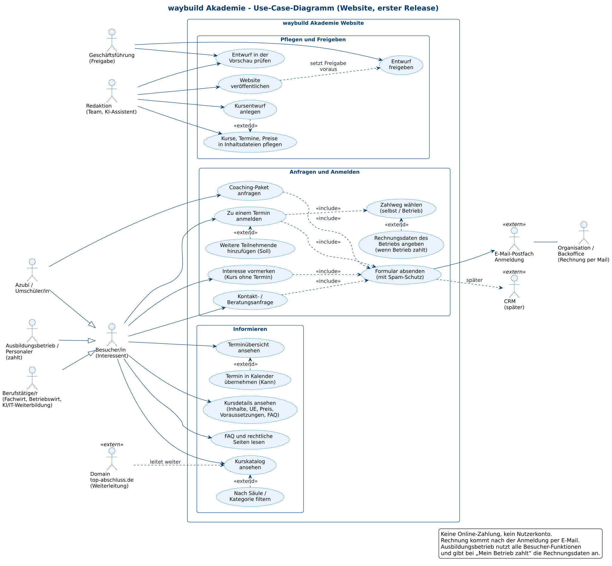

# Anforderungsdokument waybuild Akademie

Phase 1 „Konzeption“ · Stand: 13.11.2026 · Status: **Entwurf zur Freigabe**

Dieses Dokument beschreibt, **was** die Website der waybuild Akademie können muss – nicht, wie sie technisch gebaut wird.
Wie die Daten aussehen und welche Seiten es im Einzelnen gibt, steht später im Spezifikationsdokument (`03-spezifikation.md`).
Grundlage sind die Entscheidungen des Auftraggebers, das Ausgangskonzept für die IHK-Prüfungsvorbereitung, die Analyse von Vorbild-Websites
und die interne Kurskatalog-Recherche. Bei Widersprüchen gelten die Entscheidungen des Auftraggebers.

**Lesehilfe:** „Muss“ = ohne diese Funktion geht die Website nicht live. „Soll“ = gehört in den ersten Release, kann notfalls kurz danach kommen.
„Kann“ = gute Idee für später. Fachbegriffe sind im [Glossar](#6-glossar) am Ende erklärt.

---

## Inhalt

1. [Zweck und Kundennutzen](#1-zweck-und-kundennutzen)
2. [Stakeholder](#2-stakeholder)
3. [Funktionale Anforderungen (User Stories)](#3-funktionale-anforderungen-user-stories)
4. [Use-Case-Diagramm](#4-use-case-diagramm)
5. [Nichtfunktionale Anforderungen](#5-nichtfunktionale-anforderungen)
6. [Glossar](#6-glossar)
7. [Offene Fragen](#7-offene-fragen)

---

## 1. Zweck und Kundennutzen

Die waybuild Akademie bietet ausschließlich **Live-Online-Kurse** an: IHK-Prüfungsvorbereitung für Azubis und Umschüler (zuerst AP1 für alle IT-Berufe, AP2 Fachinformatik Systemintegration und individuelles Prüfungscoaching),
berufsbegleitende IHK-Weiterbildungen wie Fachwirt und Betriebswirt sowie eigene Weiterbildungen in KI, Programmierung und IT – zu fairen, klar ausgewiesenen Preisen.
Die Website ist der zentrale Ort, an dem Interessenten in wenigen Sekunden verstehen, **was sie bekommen, was es kostet, wann es stattfindet und wie sie starten**.
Anders als viele Anbieter zeigt sie Preis, Umfang (Unterrichtseinheiten) und nächsten Termin schon in der Kursübersicht und bündelt alle Starttermine auf einer Seite.
Die Anmeldung ist bewusst einfach: ein Formular pro Termin, Wahl „Ich zahle selbst“ oder „Mein Betrieb zahlt“, die Rechnung kommt danach per E-Mail – ohne Kundenkonto und ohne Online-Zahlung.
Ausbildungsbetriebe und Personaler finden alle Angaben, die sie für eine Kostenübernahme brauchen, und können ihre Azubis direkt anmelden.
Für Kurse ohne festen Termin können Interessenten unverbindlich ihr Interesse vormerken; so erkennt das Team früh, welche Kurse sich lohnen.
Für das Team ist die Website mit wenig Aufwand pflegbar: Kurse, Termine und Preise stehen in einfachen Inhaltsdateien, neue Kursideen erscheinen als gekennzeichneter Entwurf erst nach Freigabe öffentlich.
Die Website ist schnell, barrierearm, datensparsam und stellt klar, dass es sich um ein **unabhängiges Angebot und keine Veranstaltung der IHK** handelt.

---

## 2. Stakeholder

Einfluss: **hoch** = entscheidet oder bestimmt den Erfolg direkt · **mittel** = prägt Inhalte und Abläufe · **gering** = wird berücksichtigt, wirkt aber nicht direkt mit.

| Stakeholder | Ziel | Interesse an der Website | Einfluss |
|---|---|---|---|
| **Azubis und Umschüler/innen** (IT-Berufe, später kaufmännische Berufe) | Abschlussprüfung (AP1/AP2) sicher bestehen | Passenden Kurs zur eigenen Prüfung finden, Termine vor dem Prüfungstag, Preis, Ablauf, Technikbedarf; schnelle Anmeldung, oft mit Kostenübernahme durch den Betrieb | hoch (Hauptzielgruppe) |
| **Berufstätige** (Fachwirt, Betriebswirt, AEVO u. a.) | Aufstiegsfortbildung neben dem Beruf schaffen | Dauer, Zeitmodell (Abende/Samstage), Zulassungsvoraussetzungen, Gesamtpreis, Prüfung bei der IHK, ggf. Förderung | hoch |
| **Interessenten für KI-/IT-Weiterbildungen** (Fach- und Führungskräfte, Quereinsteiger) | Praxiswissen in KI, Programmierung, IT erwerben | Klare Inhalte und Lernziele, Umfang, Preis, Art des Abschlusses (Teilnahmezertifikat), Termine | mittel |
| **Ausbildungsbetriebe und Personaler** (zahlen oft) | Azubis/Mitarbeitende gut vorbereiten, Kosten planbar halten | Rechnung an die Firma, Angaben für Bestellung/Freigabe, mehrere Personen anmelden, verlässliche Termine | hoch (Zahler) |
| **Geschäftsführung** (Can, Jamil) | Wirtschaftlich tragfähiges, seriöses Akademie-Angebot | Freigabe von Kursen, Preisen und Texten; Überblick über Anmeldungen und Interesse; rechtssicherer Auftritt | hoch (entscheidet) |
| **Organisation / Backoffice** | Anmeldungen zügig und fehlerfrei bearbeiten | Vollständige, einheitlich aufgebaute Anmelde-E-Mails; Rechnungsdaten klar getrennt nach Privat/Firma; wenig Rückfragen | mittel |
| **Redaktion** (Team, KI-Assistent für Kursentwürfe) | Kurse, Termine, Preise schnell und fehlerarm pflegen | Einfache Inhaltsdateien, ein Template für alle Kurse, Entwürfe in einer Vorschau prüfbar | mittel |
| **Dozentinnen und Dozenten** (werden nicht namentlich genannt) | Gut vorbereitete, passende Teilnehmende | Korrekte Kursbeschreibung, realistische Voraussetzungen, klare Erwartungen an Technik und Anwesenheit; keine persönliche Darstellung auf der Website | mittel |
| **IHK als Prüfungsinstanz** (Behörden/Kammern) | Ordnungsgemäße Prüfungen, keine Verwechslung mit eigenen Angeboten | Keine irreführende Nähe zur IHK, korrekte Begriffe, Prüfungsgebühr klar getrennt | gering (aber rechtlich relevant) |
| **Förderstellen** (Aufstiegs-BAföG, später ggf. Arbeitsagentur) | Förderung nur bei erfüllten Voraussetzungen | Nachvollziehbarer Umfang (UE, Stundenplan) – Förderhinweise erst, wenn gesichert | gering |
| **CRM (später)** | Anfragen und Anmeldungen zentral verwalten | Formulardaten einheitlich und maschinenlesbar | gering (Zukunft) |

---

## 3. Funktionale Anforderungen (User Stories)

Aufbau jeder Story: **„Als … möchte ich …, damit …“**, dazu Priorität und prüfbare Akzeptanzkriterien (AK).
Die Akzeptanzkriterien sind später die Grundlage für die Tests in Phase 3.

### 3.1 Informieren

#### US-01 Startseite: Angebot sofort verstehen · **Muss**
Als **Besucher/in** möchte ich auf der Startseite sofort sehen, welche Kurse es gibt, für wen sie sind und wie ich starte, damit ich ohne Suchen entscheiden kann, ob die Akademie zu mir passt.
- AK1: Oberhalb der ersten Bildschirmkante (Mobil, 360 px Breite) stehen Kernversprechen, „Live-Online“ und ein Knopf zu Kursen bzw. Terminen.
- AK2: Die Startseite zeigt die drei Säulen mit je einem Einstieg und die nächsten 3–5 Starttermine mit Preis.
- AK3: Der Hinweis „unabhängiges Angebot, keine IHK-Veranstaltung“ ist auf der Startseite erreichbar (siehe US-19).

#### US-02 Kurskatalog nach Säulen und Kategorien filtern · **Muss**
Als **Besucher/in** möchte ich den Kurskatalog nach Säule (Prüfungsvorbereitung, IHK-Weiterbildung, eigene Weiterbildung) und Kategorie (z. B. IT-Berufe, Fachwirte, KI) filtern, damit ich nur die für mich relevanten Kurse sehe.
- AK1: Es gibt Filter für alle Säulen und Kategorien, die in den Kursdaten vorkommen; leere Kategorien werden nicht angeboten.
- AK2: Der gewählte Filter steht in der Adresse (z. B. `/kurse/?saeule=pruefungsvorbereitung`) und bleibt beim Teilen des Links erhalten.
- AK3: Ohne JavaScript sind alle Kurse sichtbar und nach Säulen gegliedert (Filter ist eine Verbesserung, keine Voraussetzung).
- AK4: Die Anzahl der Treffer wird angezeigt und für Screenreader angesagt.

#### US-03 Kurskarte mit Preis, Umfang und nächstem Termin · **Muss**
Als **Azubi oder Personaler/in** möchte ich schon in der Übersicht Preis, Umfang und nächsten Starttermin sehen, damit ich Kurse vergleichen kann, ohne jede Detailseite zu öffnen.
- AK1: Jede Kurskarte zeigt Titel, Säule/Kategorie, Umfang in UE (bzw. Minuten beim Coaching), Endpreis und den nächsten Starttermin.
- AK2: Hat ein Kurs keinen Termin, steht statt des Datums „Termin in Planung – Interesse vormerken“.
- AK3: Die Angaben auf der Karte stammen aus derselben Datenquelle wie Detailseite und Terminübersicht (keine abweichenden Werte möglich).

#### US-04 Kursdetailseite mit allen Angaben · **Muss**
Als **Interessent/in** möchte ich auf einer Kursseite alle wichtigen Informationen finden – Inhalte, UE, Dauer, Termine, Preis, Voraussetzungen, Ablauf, FAQ –, damit ich mich ohne Rückfrage anmelden kann.
- AK1: Jede Kursseite hat dieselbe Reihenfolge: Kopf (Titel, Kennzahlen UE · Dauer · Format · Preis, Knopf „Anmelden“ bzw. „Interesse vormerken“), Inhalte, Termine, Preis und Leistungen, Voraussetzungen, Ablauf, FAQ.
- AK2: Eine Sprungnavigation führt zu allen Abschnitten; auf dem Handy bleibt der Anmelde-Knopf erreichbar.
- AK3: Fehlt ein Pflichtabschnitt in den Kursdaten, schlägt die Veröffentlichung fehl (keine halbfertigen Seiten, siehe NFA-17).
- AK4: Bei IHK-Kursen steht, dass die IHK-Prüfungsgebühr nicht enthalten ist und die Prüfung bei der zuständigen IHK abgelegt wird.

#### US-05 Zielgruppe, Voraussetzungen und Technik klar erkennen · **Muss**
Als **Interessent/in** möchte ich wissen, für wen der Kurs geeignet ist – und für wen nicht – und welche Technik ich brauche, damit ich keinen unpassenden Kurs buche.
- AK1: Jede Kursseite hat die Abschnitte „Geeignet für“ und „Nicht geeignet für / Hinweis“ (z. B. Vorkenntnisse nötig, bundeseinheitliche Prüfung).
- AK2: Technische Voraussetzungen (Computer, Internet, Headset/Mikrofon, ggf. Kamera) und Regeln zur Teilnahme stehen auf jeder Kursseite.
- AK3: Bei IHK-Weiterbildungen werden die Zulassungsvoraussetzungen in Kurzform genannt, mit dem Hinweis, dass die IHK über die Zulassung entscheidet.

#### US-06 Ablauf in wenigen Schritten · **Soll**
Als **Besucher/in** möchte ich in 4–5 Schritten sehen, wie es von der Anmeldung bis zur Prüfung abläuft, damit ich weiß, was mich erwartet.
- AK1: Eine Seite oder ein Abschnitt „So läuft es ab“ zeigt nummerierte Schritte (z. B. Termin wählen → Anmelden → Rechnung und Zugangsdaten per E-Mail → Live-Termine → Prüfung).
- AK2: Der Ablauf ist von jeder Kursseite aus verlinkt.
- AK3: Der Schritt „Rechnung per E-Mail“ sagt, dass keine Online-Zahlung nötig ist.

#### US-07 Zentrale Terminübersicht · **Muss**
Als **Azubi oder Personaler/in** möchte ich alle Starttermine aller Kurse auf einer Seite sehen, damit ich schnell einen Kurs passend zu meinem Prüfungstermin finde.
- AK1: Eine Seite „Termine“ listet alle künftigen Durchführungen mit Kurs, Zeitraum, Wochentagen, Uhrzeit, Preis und Knopf „Anmelden“.
- AK2: Die Liste ist nach Startdatum sortiert und nach Säule filterbar; vergangene Termine erscheinen nicht (siehe US-25).
- AK3: Auf dem Handy ist die Liste ohne seitliches Scrollen lesbar (Karten statt breiter Tabelle).
- AK4: Der „Anmelden“-Knopf öffnet das Anmeldeformular mit vorausgewähltem Termin.

#### US-08 Status eines Termins · **Soll**
Als **Interessent/in** möchte ich sehen, ob ein Termin noch frei, fast voll, ausgebucht oder abgesagt ist, damit ich nicht umsonst anfrage.
- AK1: Jeder Termin hat genau einen Status aus: „Plätze frei“, „Wenige Plätze“, „Ausgebucht – Warteliste“, „Abgesagt“.
- AK2: Bei „Ausgebucht – Warteliste“ führt der Knopf zur Wartelisten-Anfrage statt zur Anmeldung; „Abgesagt“ ist nicht buchbar.
- AK3: Widersprüchliche Anzeigen (z. B. „kein Termin“ neben einer Terminliste) sind ausgeschlossen, weil der Status nur an einer Stelle gepflegt wird.

#### US-09 Termin in den eigenen Kalender übernehmen · **Kann**
Als **angemeldete/r Teilnehmer/in** möchte ich die Kurstermine als Kalenderdatei laden, damit ich keinen Abend verpasse.
- AK1: Je Durchführung gibt es eine Kalenderdatei (`.ics`) mit allen Unterrichtsabenden.
- AK2: Die Datei enthält Kursname, Uhrzeit (Zeitzone Europe/Berlin) und den Hinweis „Live-Online, Zugangslink folgt per E-Mail“ – aber keinen Zugangslink.

#### US-28 Prüfungstermin als Orientierung · **Soll**
Als **Azubi** möchte ich bei Prüfungsvorbereitungen sehen, auf welchen IHK-Prüfungstermin ein Kurs zielt, damit ich den richtigen Durchgang wähle.
- AK1: Jede Durchführung einer Prüfungsvorbereitung nennt den zugehörigen schriftlichen Prüfungstermin (z. B. „Prüfung Frühjahr 2027“ mit Datum).
- AK2: Daneben steht der Hinweis, dass der verbindliche Termin in der Einladung der zuständigen IHK steht.

#### US-30 Kurse durchsuchen · **Kann**
Als **Besucher/in** möchte ich Kurse per Suchbegriff finden (z. B. „Python“, „Systemintegration“), damit ich schneller ans Ziel komme.
- AK1: Ein Suchfeld im Katalog findet Kurse über Titel, Kategorie und Stichwörter.
- AK2: Die Suche läuft ohne externen Suchdienst (keine Datenübertragung an Dritte).

### 3.2 Anfragen und Anmelden

#### US-10 Zu einem Termin anmelden · **Muss**
Als **Interessent/in** möchte ich mich über ein einfaches Formular verbindlich zu einem bestimmten Termin anmelden, damit mein Platz reserviert ist.
- AK1: Das Formular zeigt oben Kurs, Zeitraum und Preis des gewählten Termins; der Termin ist änderbar, aber vorausgewählt.
- AK2: Pflichtfelder sind nur: Vorname, Nachname, E-Mail, Zahlweg, Rechnungsanschrift sowie die Bestätigung der Teilnahmebedingungen und der Kenntnisnahme von Datenschutz und Widerruf. Telefon und Nachricht sind freiwillig.
- AK3: Fehler werden direkt am Feld in Textform erklärt (nicht nur farblich) und die Eingaben bleiben erhalten.
- AK4: Der Absende-Knopf ist eindeutig beschriftet mit „Zahlungspflichtig anmelden“ (Button-Lösung nach § 312j BGB).

#### US-11 Zahlweg wählen: selbst zahlen oder Betrieb zahlt · **Muss**
Als **Teilnehmer/in** möchte ich wählen, ob ich selbst zahle oder mein Betrieb zahlt, damit die Rechnung an die richtige Stelle geht.
- AK1: Es gibt genau zwei Auswahlmöglichkeiten: „Ich zahle selbst“ und „Mein Betrieb zahlt (Rechnung an die Firma)“.
- AK2: Bei „Ich zahle selbst“ wird die Privatanschrift abgefragt; bei „Mein Betrieb zahlt“ Firmenname, Anschrift, Ansprechperson und Rechnungs-E-Mail, optional Bestellnummer/Kostenstelle.
- AK3: Je nach Auswahl werden nur die passenden Felder angezeigt und geprüft; ohne JavaScript sind beide Bereiche sichtbar und klar beschriftet.

#### US-12 Bestätigung und Rechnung per E-Mail, keine Online-Zahlung · **Muss**
Als **Teilnehmer/in** möchte ich nach dem Absenden sofort eine Bestätigung sehen und wissen, wie es weitergeht, damit ich sicher bin, dass meine Anmeldung angekommen ist.
- AK1: Nach dem Absenden erscheint eine Bestätigungsseite mit Zusammenfassung und dem Hinweis „Du erhältst die Rechnung per E-Mail; eine Online-Zahlung ist nicht nötig.“
- AK2: Die Anmeldung geht vollständig an das Anmelde-Postfach (siehe US-24).
- AK3: Die angemeldete Person erhält eine automatische Eingangsbestätigung per E-Mail mit den Anmeldedaten (Soll-Bestandteil; falls technisch erst später möglich, nennt die Bestätigungsseite eine Bearbeitungszeit).
- AK4: Schlägt das Senden fehl, erscheint eine verständliche Fehlermeldung mit der E-Mail-Adresse für die Anmeldung als Ausweg; es gehen keine Eingaben verloren.

#### US-13 Mehrere Teilnehmende anmelden · **Soll**
Als **Ausbilder/in oder Personaler/in** möchte ich mehrere Azubis in einem Vorgang anmelden, damit ich nicht für jede Person ein eigenes Formular ausfüllen muss.
- AK1: Bei beiden Zahlwegen können weitere Teilnehmende (Vorname, Nachname, E-Mail) hinzugefügt werden, insgesamt höchstens 5 Personen.
- AK2: Die Zusammenfassung zeigt Anzahl der Teilnehmenden und Gesamtpreis.
- AK3: In der Anmelde-E-Mail ist jede teilnehmende Person einzeln aufgeführt.

#### US-14 Interesse vormerken (Kurs ohne Termin) · **Muss**
Als **Interessent/in** möchte ich mein Interesse an einem Kurs ohne festen Termin unverbindlich vormerken, damit ich informiert werde, sobald es einen Termin gibt.
- AK1: Kurse ohne buchbaren Termin zeigen statt „Anmelden“ den Knopf „Interesse vormerken“.
- AK2: Das Formular fragt nur Name, E-Mail, gewünschten Kurs und optional einen Wunschzeitraum ab; es ist klar als unverbindlich gekennzeichnet.
- AK3: Die Einwilligung zur Benachrichtigung ist ausdrücklich und nicht vorausgewählt; der Widerruf ist jederzeit per E-Mail möglich.

#### US-15 Coaching-Paket anfragen · **Muss**
Als **Azubi** möchte ich ein Prüfungscoaching-Paket (Einzelcoaching, 3er-Paket, Intensivbegleitung) anfragen und mein Anliegen beschreiben, damit wir passende Online-Termine vereinbaren.
- AK1: Die Coaching-Seite zeigt alle Pakete mit Umfang (je 60 Minuten) und Endpreis sowie den Knopf „Paket anfragen“.
- AK2: Das Anfrageformular enthält Paketwahl, Anliegen (z. B. Projektantrag, Dokumentation, Präsentation, Fachgespräch), Prüfungszeitraum, Wunschzeiten und Zahlweg (wie US-11).
- AK3: Auf Seite und Formular steht, dass Projektantrag, Dokumentation und alle Prüfungsleistungen von den Prüfungsteilnehmenden selbst erstellt werden; Coaching ist Beratung, Rückmeldung und Training.
- AK4: Die Anfrage ist zunächst unverbindlich; der Vertrag kommt erst mit der Terminabstimmung zustande (Text auf der Bestätigungsseite).

#### US-16 Kontakt- und Beratungsanfrage · **Muss**
Als **Besucher/in** möchte ich eine Frage stellen oder eine Beratung anfragen, damit ich Unklarheiten vor der Anmeldung kläre.
- AK1: Ein Kontaktformular (Name, E-Mail, Nachricht, optional Telefon, Kursbezug und Rückrufwunsch) ist von jeder Seite aus in höchstens zwei Klicks erreichbar.
- AK2: Die Anfrage geht an das allgemeine Postfach; die Bestätigungsseite nennt die übliche Antwortzeit.
- AK3: Zusätzlich ist die allgemeine E-Mail-Adresse sichtbar, für alle, die kein Formular nutzen möchten.

#### US-17 Häufige Fragen (FAQ) · **Muss**
Als **Besucher/in** möchte ich Antworten auf typische Fragen finden (Ablauf, Technik, Zahlung, Prüfung, Storno), damit ich nicht nachfragen muss.
- AK1: Es gibt eine FAQ-Seite mit Gruppen (Anmeldung & Zahlung, Ablauf & Technik, Prüfung & IHK, Coaching) und zusätzlich kursbezogene FAQ auf jeder Kursseite.
- AK2: Fragen sind ausklappbar, per Tastatur bedienbar und auch ohne JavaScript vollständig lesbar.
- AK3: Die FAQ enthält die Frage „Ist der Kurs eine offizielle IHK-Veranstaltung?“ mit der klaren Antwort „Nein“.

#### US-18 Wer unterrichtet? (ohne Namen) · **Soll**
Als **Interessent/in** möchte ich erfahren, welche Erfahrung die Lehrenden mitbringen, damit ich der Qualität vertrauen kann.
- AK1: Eine Seite oder ein Abschnitt „Über uns“ beschreibt die Lehrenden allgemein, z. B. „erfahrene IHK-Prüfer und Dozenten mit langjähriger Praxis“.
- AK2: Es werden keine Namen, Fotos oder persönlichen Lebensläufe von Dozenten gezeigt; Aussagen zu Erfolgen erscheinen nur mit belegbarer Quelle.
- AK3: Die Seite zeigt, wer hinter der Akademie steht (Anbieter, Kontaktweg).

#### US-19 Hinweis „unabhängiges Angebot, keine IHK-Veranstaltung“ · **Muss**
Als **Interessent/in** möchte ich klar erkennen, dass die Akademie ein unabhängiger Anbieter ist, damit ich nicht glaube, bei der IHK selbst zu buchen.
- AK1: Auf jeder Seite von Prüfungsvorbereitungen und IHK-Weiterbildungen steht ein kurzer, sichtbarer Hinweis: unabhängiges Angebot, keine Veranstaltung oder Dienstleistung der IHK; die Prüfung wird bei der zuständigen IHK abgelegt.
- AK2: Die Website verwendet keine IHK-Logos und keine Formulierungen, die eine Trägerschaft, Zertifizierung oder Partnerschaft der IHK nahelegen (siehe NFA-20).
- AK3: Beim Prüfungscoaching steht zusätzlich, dass keine Einflussnahme auf Prüfung oder Bewertung erfolgt.

#### US-20 Rechtliche Seiten · **Muss**
Als **Besucher/in** möchte ich Impressum, Datenschutzerklärung, Teilnahmebedingungen (AGB) und Widerrufsbelehrung finden, damit ich weiß, mit wem ich einen Vertrag schließe und welche Rechte ich habe.
- AK1: Impressum, Datenschutz, Teilnahmebedingungen/AGB und Widerrufsbelehrung (mit Muster-Widerrufsformular) sind von jeder Seite aus im Fußbereich mit einem Klick erreichbar.
- AK2: Alle Formulare verlinken an der Bestätigungsstelle auf Teilnahmebedingungen, Widerrufsbelehrung und Datenschutz.
- AK3: Die Texte werden vor dem Livegang fachlich geprüft und freigegeben; bis dahin sind sie als Entwurf gekennzeichnet und nur in der Vorschau sichtbar.

### 3.3 Pflegen, Freigeben, Betreiben

#### US-21 Kurse, Termine und Preise über Inhaltsdateien pflegen · **Muss**
Als **Redaktion** möchte ich Kurse, Termine und Preise in einfachen Inhaltsdateien pflegen, damit Änderungen ohne Programmierkenntnisse möglich sind.
- AK1: Jeder Kurs ist eine eigene Inhaltsdatei mit festen Feldern (u. a. Titel, Säule, Kategorie, UE, Dauer, Preis, Inhalte, Voraussetzungen, FAQ, Status); Termine sind dem Kurs zugeordnet.
- AK2: Ein neuer Kurs entsteht durch Anlegen einer neuen Datei nach Vorlage – ohne Änderung am Seiten-Code.
- AK3: Beim Veröffentlichen werden die Dateien geprüft; fehlende Pflichtfelder oder ungültige Werte (z. B. Preis ohne Zahl, Termin ohne Datum) verhindern die Veröffentlichung mit einer verständlichen Meldung.
- AK4: Eine Preis- oder Terminänderung an einer Stelle wirkt automatisch auf Karte, Kursseite, Terminübersicht und Formular.

#### US-22 Entwürfe kennzeichnen und nur in der Vorschau zeigen · **Muss**
Als **Geschäftsführung** möchte ich, dass noch nicht freigegebene Kurse (z. B. vom KI-Assistenten vorbereitete Kursentwürfe) deutlich als „Entwurf“ markiert und nur intern sichtbar sind, damit nichts Ungeprüftes öffentlich wird.
- AK1: Jeder Kurs hat einen Status „Entwurf“ oder „Freigegeben“; neue Kurse starten immer als „Entwurf“.
- AK2: In der Vorschau-Version erscheinen Entwürfe mit einem gut sichtbaren Kennzeichen „Entwurf – nicht freigegeben“ auf Karte und Kursseite; Anmelden ist dort nicht möglich.
- AK3: Die öffentliche Version enthält keine Entwürfe – weder als Seite noch in Sitemap, Suche, Terminübersicht oder strukturierten Daten.
- AK4: Die Vorschau ist für Suchmaschinen gesperrt (`noindex`) und nicht öffentlich verlinkt.

#### US-23 Entwurf freigeben · **Muss**
Als **Geschäftsführung** möchte ich einen Entwurf nach Prüfung von Inhalt, Dauer und Preis freigeben, damit er öffentlich buchbar wird.
- AK1: Die Freigabe erfolgt durch Ändern des Status auf „Freigegeben“ und wird mit Datum und freigebender Person festgehalten (Änderungsverlauf im Repository).
- AK2: Ein freigegebener Kurs erscheint nach der nächsten Veröffentlichung im öffentlichen Katalog.
- AK3: Preis und Kurstexte werden nur mit Freigabe veröffentlicht; Preisvorschläge in Entwürfen sind als „Vorschlag“ erkennbar.

#### US-24 Anmeldungen strukturiert im Postfach empfangen · **Muss**
Als **Backoffice** möchte ich jede Anmeldung als einheitlich aufgebaute E-Mail im Anmelde-Postfach erhalten, damit ich die Rechnung ohne Rückfragen erstellen kann.
- AK1: Der Betreff enthält Art (Anmeldung / Interesse / Coaching / Kontakt), Kurs und Startdatum.
- AK2: Der Inhalt führt alle Angaben in fester Reihenfolge auf; Rechnungsempfänger (Privat oder Firma) ist deutlich gekennzeichnet.
- AK3: Anmeldungen gehen an das Anmelde-Postfach, allgemeine Anfragen an das allgemeine Postfach.
- AK4: Die E-Mail ist so aufgebaut, dass ein späteres CRM die Daten automatisch übernehmen kann (siehe US-29).

#### US-25 Vergangene Termine automatisch ausblenden · **Soll**
Als **Redaktion** möchte ich, dass abgelaufene Termine nicht mehr buchbar angezeigt werden, damit keine Anmeldungen zu vergangenen Kursen eingehen.
- AK1: Termine, deren Anmeldeschluss (oder Startdatum, falls kein Anmeldeschluss gesetzt) vorbei ist, erscheinen nicht mehr als buchbar.
- AK2: Die Website wird mindestens täglich automatisch neu erzeugt, damit dies ohne manuelles Zutun gilt.
- AK3: Hat ein Kurs danach keinen Termin mehr, schaltet er automatisch auf „Interesse vormerken“ um.

#### US-26 Förderhinweise nur nach Freigabe · **Soll**
Als **Geschäftsführung** möchte ich Hinweise auf Förderungen (z. B. Aufstiegs-BAföG) je Kurs ein- und ausschalten, damit nur gesicherte Fördermöglichkeiten genannt werden.
- AK1: Förderhinweise sind je Kurs ein eigenes Feld und standardmäßig ausgeschaltet.
- AK2: Ohne Freigabe erscheint auf der Website kein Hinweis auf Förderung (weder Text noch Siegel).
- AK3: Eingeschaltete Hinweise nennen die zuständige Stelle und, dass diese über die Förderung entscheidet.

#### US-27 Mehr-Domain-Fähigkeit (top-abschluss.de) · **Muss**
Als **Geschäftsführung** möchte ich, dass top-abschluss.de vorerst auf die Akademie weiterleitet und später eine eigene Seite werden kann, damit beide Marken genutzt werden können.
- AK1: Alle Aufrufe von top-abschluss.de (mit und ohne „www“, jeder Pfad) leiten dauerhaft (HTTP 301) auf die passende Seite von waybuild-akademie.de bzw. auf die Startseite weiter.
- AK2: Suchmaschinen sehen nur waybuild-akademie.de als Hauptadresse (kanonische Adresse auf jeder Seite).
- AK3: Der Aufbau erlaubt später eine eigene top-abschluss-Seite mit eigenen Texten, die dieselben Kurs- und Termindaten nutzt, ohne die Daten doppelt zu pflegen.

#### US-29 Übergabe an ein späteres CRM · **Kann**
Als **Geschäftsführung** möchte ich, dass Anmeldungen und Anfragen später automatisch in ein CRM übernommen werden können, damit kein Abtippen nötig ist.
- AK1: Jede Formularübermittlung enthält zusätzlich einen maschinenlesbaren Block (z. B. JSON) mit festen Feldnamen und einer eindeutigen Vorgangsnummer.
- AK2: Die Anbindung erfolgt ohne Änderung der Formulare auf der Website.

### 3.4 Bewusst NICHT im Umfang

Diese Punkte sind ausdrücklich ausgeschlossen, damit der Umfang klar bleibt:

| Nicht enthalten | Grund |
|---|---|
| **Online-Zahlung** (Karte, PayPal, Lastschrift im Formular), Warenkorb, Checkout | Entscheidung des Auftraggebers: Anmeldung per Formular, Rechnung per E-Mail |
| **Nutzerkonten / Login** für Teilnehmende oder Betriebe | Nicht nötig; vermeidet Pflegeaufwand und zusätzliche Datenhaltung |
| **Dozentenprofile mit Namen, Fotos oder Lebenslauf** | Entscheidung des Auftraggebers; Lehrende werden nur allgemein beschrieben |
| Präsenzkurse, Raum- oder Ortsangaben | Alle Kurse sind ausschließlich Live-Online |
| Lernplattform, Kursmaterial-Download, Zugangslinks auf der Website | Läuft außerhalb der Website; Zugang kommt per E-Mail |
| Blog, Podcast, Karrierepfade, Prämienprogramm | Hoher Pflegeaufwand, für den Start nicht nötig |
| KI-Chat-Berater auf der Website | Zusätzliche Datenschutzpflichten; frühestens später prüfen |
| Bewertungs-Karussells, Siegel oder Zahlen ohne Beleg | Nur echte, belegbare Aussagen; statische Darstellung |
| Abfrage des Geburtsdatums oder Datenweitergabe an Dritte als Pflicht | Datensparsamkeit |
| Förderhinweise ohne Freigabe | Entscheidung des Auftraggebers: erst nennen, wenn sicher möglich |

### 3.5 Übersicht der User Stories

| ID | Kurztitel | Priorität |
|---|---|---|
| US-01 | Startseite: Angebot sofort verstehen | Muss |
| US-02 | Kurskatalog nach Säulen/Kategorien filtern | Muss |
| US-03 | Kurskarte mit Preis, UE, nächstem Termin | Muss |
| US-04 | Kursdetailseite mit allen Angaben | Muss |
| US-05 | Zielgruppe, Voraussetzungen, Technik | Muss |
| US-06 | Ablauf in wenigen Schritten | Soll |
| US-07 | Zentrale Terminübersicht | Muss |
| US-08 | Status eines Termins | Soll |
| US-09 | Termin in Kalender übernehmen | Kann |
| US-10 | Zu einem Termin anmelden | Muss |
| US-11 | Zahlweg wählen (selbst / Betrieb) | Muss |
| US-12 | Bestätigung, Rechnung per E-Mail | Muss |
| US-13 | Mehrere Teilnehmende anmelden | Soll |
| US-14 | Interesse vormerken | Muss |
| US-15 | Coaching-Paket anfragen | Muss |
| US-16 | Kontakt-/Beratungsanfrage | Muss |
| US-17 | FAQ | Muss |
| US-18 | Wer unterrichtet? (ohne Namen) | Soll |
| US-19 | Hinweis „keine IHK-Veranstaltung“ | Muss |
| US-20 | Rechtliche Seiten | Muss |
| US-21 | Pflege über Inhaltsdateien | Muss |
| US-22 | Entwürfe nur in der Vorschau | Muss |
| US-23 | Entwurf freigeben | Muss |
| US-24 | Anmeldungen strukturiert im Postfach | Muss |
| US-25 | Vergangene Termine ausblenden | Soll |
| US-26 | Förderhinweise nur nach Freigabe | Soll |
| US-27 | Mehr-Domain (top-abschluss.de) | Muss |
| US-28 | Prüfungstermin als Orientierung | Soll |
| US-29 | Übergabe an späteres CRM | Kann |
| US-30 | Kurse durchsuchen | Kann |

**Summe:** 30 User Stories – 20 Muss, 7 Soll, 3 Kann.

---

## 4. Use-Case-Diagramm

Das Diagramm zeigt, **wer** mit der Website **was** tun kann. Die Website ist der große Rahmen („Systemgrenze“).
Links stehen die Menschen, die die Website nutzen; Azubis, Berufstätige und Ausbildungsbetriebe sind besondere Arten von Besuchern (Pfeil mit leerer Spitze).
Rechts stehen Systeme und Rollen außerhalb der Website: das E-Mail-Postfach für Anmeldungen, das Backoffice (erstellt die Rechnung), die Weiterleitung von top-abschluss.de und ein späteres CRM.

- **«include»** heißt: Dieser Schritt gehört immer dazu (z. B. jede Anmeldung enthält die Wahl des Zahlwegs und das Absenden mit Spam-Schutz).
- **«extend»** heißt: Dieser Schritt kommt nur manchmal dazu (z. B. Rechnungsdaten des Betriebs nur, wenn der Betrieb zahlt).

Quelltext: [`diagramme/1-use-cases.puml`](diagramme/1-use-cases.puml) · Neu erzeugen: siehe [`diagramme/LIESMICH.md`](diagramme/LIESMICH.md)

---

## 5. Nichtfunktionale Anforderungen

Nichtfunktionale Anforderungen beschreiben, **wie gut** die Website arbeiten muss. Jede hat ein messbares Kriterium, das in Phase 3 geprüft wird.

### 5.1 Leistung

| ID | Anforderung | Messbares Kriterium |
|---|---|---|
| NFA-01 | Sehr gute Gesamtbewertung | Lighthouse (mobil, gedrosselt) ≥ 95 in Leistung, Barrierefreiheit, Best Practices und SEO – für Startseite, Kurskatalog, eine Kursseite, Terminübersicht und Anmeldeformular |
| NFA-02 | Schneller Seitenaufbau | Largest Contentful Paint (LCP) < 2,0 s, Cumulative Layout Shift (CLS) < 0,1, Interaction to Next Paint (INP) < 200 ms (mobil, Lighthouse/PageSpeed); übertragene Datenmenge der Startseite < 500 KB, JavaScript je Seite < 50 KB (komprimiert) |

### 5.2 Barrierefreiheit und Bedienung

| ID | Anforderung | Messbares Kriterium |
|---|---|---|
| NFA-03 | Barrierefreiheit nach WCAG 2.2 Stufe AA (Anforderungen des Barrierefreiheitsstärkungsgesetzes, BFSG) | Automatische Prüfung (z. B. axe) ohne Verstöße auf allen Seitentypen; manueller Test: vollständig per Tastatur bedienbar, sichtbarer Fokus, Kontrast Text ≥ 4,5 : 1, Formularfehler als Text, Test mit einem Screenreader (NVDA oder VoiceOver) für Anmeldung bestanden; Erklärung zur Barrierefreiheit vorhanden |
| NFA-04 | Mobil zuerst | Alle Seiten ab 320 px Breite ohne seitliches Scrollen und ohne abgeschnittene Inhalte; Bedienelemente mindestens 44 × 44 px; Text bis 200 % vergrößerbar ohne Funktionsverlust; getestet auf aktuellem iOS-Safari und Android-Chrome |
| NFA-05 | Funktioniert ohne JavaScript | Katalog, Kursseiten, Terminübersicht, FAQ und Formulare sind ohne JavaScript nutzbar und absendbar; JavaScript verbessert nur (Filter, Ein-/Ausblenden von Feldern) |
| NFA-06 | Verständliche Sprache, Du-Ansprache | Durchgehend „Du“ (klein geschrieben), kurze Sätze, Fachbegriffe beim ersten Auftreten erklärt; Prüfung aller Seiten gegen eine Stil-Checkliste vor Freigabe |
| NFA-07 | Unterstützte Browser | Jeweils die zwei aktuellen Hauptversionen von Chrome, Edge, Firefox und Safari (macOS und iOS) ohne Darstellungs- oder Funktionsfehler |

### 5.3 Datenschutz

| ID | Anforderung | Messbares Kriterium |
|---|---|---|
| NFA-08 | Keine Tracker ohne Einwilligung | Beim ersten Aufruf werden keine Cookies gesetzt und keine Analyse- oder Werbedienste geladen (Prüfung im Browser-Entwicklerwerkzeug); eine spätere Reichweitenmessung nur cookielos oder mit vorheriger Einwilligung |
| NFA-09 | Keine externen Schriften und CDNs | Alle Schriften, Skripte, Bilder und Stile werden von der eigenen Domain geladen; Netzwerkprotokoll jeder Seite zeigt keine Anfragen an Fremd-Domains (Ausnahme: der Formular-Versand, falls über einen in der Datenschutzerklärung genannten Dienstleister) |
| NFA-10 | Datensparsame Formulare | Nur die in US-10, US-14, US-15, US-16 genannten Pflichtfelder; kein Geburtsdatum; Zweck jedes Formulars direkt am Formular erklärt; keine Speicherung der Formulardaten in einer Datenbank auf dem Webserver; Lösch- und Aufbewahrungsregeln in der Datenschutzerklärung beschrieben |

### 5.4 Sicherheit

| ID | Anforderung | Messbares Kriterium |
|---|---|---|
| NFA-11 | Verschlüsselte Verbindung | Alle Seiten nur über HTTPS (TLS 1.2 oder höher), HTTP leitet per 301 auf HTTPS um, HSTS aktiv; SSL-Labs-Bewertung mindestens A |
| NFA-12 | Sicherheits-Header | Content-Security-Policy, X-Content-Type-Options, Referrer-Policy und Permissions-Policy gesetzt; Mozilla HTTP Observatory mindestens B+ |
| NFA-13 | Spam-Schutz ohne Google reCAPTCHA | Formulare sind durch unsichtbare Maßnahmen geschützt (z. B. verstecktes Lockfeld, Mindest-Ausfüllzeit, Begrenzung der Anfragen je Zeitraum, ggf. datenschutzfreundliche Rechenaufgabe ohne Drittanbieter); kein Google reCAPTCHA, keine Bilderrätsel; Ziel: weniger als 5 % Spam unter den eingehenden Formular-E-Mails im ersten Betriebsmonat |
| NFA-14 | Sichere Eingabeverarbeitung | Alle Eingaben werden auch serverseitig geprüft (Länge, Format, Pflichtfelder); Schutz gegen Einschleusen von Mail-Kopfzeilen und Schadcode; Test mit typischen Angriffseingaben ohne Fehlverhalten |

### 5.5 Auffindbarkeit (SEO)

| ID | Anforderung | Messbares Kriterium |
|---|---|---|
| NFA-15 | Strukturierte Daten für Kurse und Termine | Jede Kursseite enthält strukturierte Daten nach schema.org `Course` mit `CourseInstance` (Kursmodus „online“, Zeitraum, Preis als `Offer`); Termine zusätzlich als `Event` (Teilnahmeart online); Prüfung mit dem Rich-Results-Test und dem Schema-Validator ohne Fehler |
| NFA-16 | Sprechende, stabile Adressen | Kursadressen nach Muster `/kurse/<kurs-name>/` (klein, ohne Umlaute, mit Bindestrichen, z. B. `/kurse/ap1-it-berufe/`); keine IDs oder Parameter für Inhalte; jede Seite mit eigenem Titel, Beschreibung und kanonischer Adresse; `sitemap.xml` und `robots.txt` vorhanden; geänderte Adressen leiten per 301 weiter |

### 5.6 Wartbarkeit

| ID | Anforderung | Messbares Kriterium |
|---|---|---|
| NFA-17 | Kurse als Inhaltsdateien mit Prüfung | Alle Kurs-, Termin- und Preisdaten liegen in Inhaltsdateien im Repository; ein Schema prüft Pflichtfelder und Datentypen beim Erzeugen der Website; ein fehlerhafter Eintrag stoppt die Veröffentlichung mit verständlicher Meldung |
| NFA-18 | Ein Template, eine Datenquelle | Alle Kursseiten nutzen dasselbe Seiten-Template; Karte, Kursseite, Terminübersicht, Formular und strukturierte Daten lesen dieselben Daten; ein neuer Kurs ist ohne Code-Änderung in unter 30 Minuten angelegt (geprüft mit der Benutzeranleitung) |
| NFA-19 | Getrennte Vorschau und Live-Version | Vorschau (mit Entwürfen, `noindex`) und Live-Version (nur Freigegebenes) entstehen aus demselben Stand; automatisierte Prüfung, dass die Live-Version keinen Entwurf enthält |

### 5.7 Rechtssicherheit

| ID | Anforderung | Messbares Kriterium |
|---|---|---|
| NFA-20 | Keine IHK-Trägerschaft suggerieren | Keine IHK-Logos, keine Formulierungen wie „IHK-Kurs“, „offizieller IHK-Partner“ oder „IHK-zertifiziert“ für eigene Leistungen; Prüfungsvorbereitungen heißen „Vorbereitung auf die IHK-Prüfung …“; Hinweis gemäß US-19 auf allen betroffenen Seiten; Textprüfung vor jeder Freigabe anhand einer Begriffsliste |
| NFA-21 | Richtige Preisbegriffe und Endpreise | Es heißt „Teilnahmegebühr“ oder „Kurspreis“, nie „Prüfungsgebühr“; alle Preise sind Endpreise (inklusive ggf. anfallender Umsatzsteuer) mit Angabe, was enthalten ist; Hinweis, dass die IHK-Prüfungsgebühr nicht enthalten ist; Einführungspreise nur mit klarer zeitlicher oder mengenmäßiger Begrenzung |
| NFA-22 | Richtige Abschlussbezeichnungen | Eigene Weiterbildungen enden mit „Teilnahmezertifikat der waybuild Akademie“; kein Zusatz „(IHK)“ oder „Geprüfte/r“ bei eigenen Kursen; öffentlich-rechtliche Abschlüsse werden nur als Prüfungsziel bei der IHK genannt |
| NFA-23 | Nur rechtlich einwandfreie Medien | Nur Bilder, Grafiken und Schriften mit geklärten Nutzungsrechten; Lizenznachweise im Repository; keine Fotos von Dozenten |

### 5.8 Verfügbarkeit und Betrieb

| ID | Anforderung | Messbares Kriterium |
|---|---|---|
| NFA-24 | Statisches Hosting | Alle Seiten sind fertig erzeugte, statische Dateien ohne Datenbank und ohne Server-Programm zur Seitenauslieferung; Verfügbarkeit ≥ 99,5 % im Monat (gemessen mit einem Erreichbarkeitsmonitor) |
| NFA-25 | Ausfallsichere Formulare | Fällt der Formular-Versand aus, zeigt die Website eine Fehlermeldung mit E-Mail-Adresse als Ausweg; der Versand wird monatlich mit einer Testanmeldung geprüft; jede Veröffentlichung ist über das Repository auf den vorherigen Stand zurücksetzbar |

**Summe:** 25 nichtfunktionale Anforderungen (NFA-01 bis NFA-25).

---

## 6. Glossar

| Begriff | Erklärung |
|---|---|
| **AEVO** | Ausbilder-Eignungsverordnung; die Prüfung bei der IHK berechtigt, im Betrieb auszubilden („Ausbilderschein“). |
| **Akzeptanzkriterium (AK)** | Prüfbare Bedingung, die erfüllt sein muss, damit eine User Story als fertig gilt. |
| **AP1 / AP2** | Abschlussprüfung Teil 1 und Teil 2 der gestreckten Abschlussprüfung. AP1 liegt etwa zur Mitte der Ausbildung und ist für alle sieben IT-Berufe gleich; AP2 am Ende ist je Beruf bzw. Fachrichtung verschieden. |
| **Astro** | Werkzeug, mit dem die Website aus Inhaltsdateien und Vorlagen zu fertigen, statischen Seiten erzeugt wird. |
| **Aufstiegs-BAföG (AFBG)** | Staatliche Förderung für Aufstiegsfortbildungen (z. B. Fachwirt, Betriebswirt) mit Zuschuss und zinsgünstigem Darlehen. Wird auf der Website erst erwähnt, wenn die Förderfähigkeit gesichert ist. |
| **AZAV** | Akkreditierungs- und Zulassungsverordnung Arbeitsförderung; Zulassung, die ein Bildungsträger braucht, damit Kurse z. B. mit Bildungsgutschein der Arbeitsagentur gefördert werden können. |
| **Bachelor / Master Professional** | Offizielle Zusatzbezeichnungen für höhere Berufsabschlüsse (z. B. Wirtschaftsfachwirt = Bachelor Professional, Betriebswirt = Master Professional). Kein Hochschulabschluss. |
| **Backoffice** | Interne Organisation, die Anmeldungen bearbeitet und Rechnungen per E-Mail verschickt. |
| **Berufsspezialist** | Erste Stufe der höheren Berufsbildung (DQR-Niveau 5), z. B. im IT-Bereich. |
| **Betriebswirt (IHK)** | Höchste kaufmännische IHK-Fortbildungsstufe, baut meist auf einem Fachwirt auf; Prüfung bei der IHK. |
| **BFSG** | Barrierefreiheitsstärkungsgesetz; verpflichtet u. a. Anbieter von Online-Diensten für Verbraucher zu barrierefreien Angeboten. |
| **Bildungsgutschein** | Förderung der Arbeitsagentur/des Jobcenters; nur für AZAV-zugelassene Kurse möglich. |
| **CRM** | Kundenverwaltungssystem (Customer Relationship Management); soll später Anfragen und Anmeldungen übernehmen. |
| **Durchführung / Termin** | Ein konkreter Kursdurchgang eines Kurses mit Startdatum, Enddatum, Wochentagen und Uhrzeit. Ein Kurs kann mehrere Durchführungen haben. |
| **Endpreis** | Der Preis, den Teilnehmende bzw. Betriebe tatsächlich zahlen, inklusive aller Bestandteile und ggf. Umsatzsteuer. |
| **Entwurf** | Kurs mit Status „nicht freigegeben“, z. B. ein vom KI-Assistenten vorbereiteter Kursvorschlag. Nur in der Vorschau sichtbar und gekennzeichnet, nicht buchbar. |
| **Fachwirt (IHK)** | Berufsbegleitende Aufstiegsfortbildung für Fachkräfte mit Berufserfahrung (z. B. Wirtschafts-, Handels-, Personalfachwirt); Prüfung bei der IHK. |
| **FISI** | Fachinformatiker/in Fachrichtung Systemintegration. |
| **Freigabe** | Entscheidung der Geschäftsführung, dass ein Kurs (Inhalt, Dauer, Preis) oder Text öffentlich erscheinen darf. |
| **IHK** | Industrie- und Handelskammer; nimmt die Abschluss- und Fortbildungsprüfungen ab. Die waybuild Akademie ist ein unabhängiger Anbieter und keine IHK-Einrichtung. |
| **Inhaltsdatei** | Einfache Textdatei im Repository, in der ein Kurs mit allen Angaben (Felder wie Titel, UE, Preis, Termine) steht. Daraus entstehen die Seiten automatisch. |
| **Interesse vormerken** | Unverbindliche Anfrage für einen Kurs ohne festen Termin; die Person wird benachrichtigt, sobald ein Termin feststeht. |
| **IT-Berufe (sieben)** | Fachinformatiker/in (Anwendungsentwicklung, Systemintegration, Daten- und Prozessanalyse, Digitale Vernetzung), IT-System-Elektroniker/in, Kaufleute für IT-System-Management, Kaufleute für Digitalisierungsmanagement. |
| **Kategorie** | Untergliederung innerhalb einer Säule, z. B. „IT-Berufe“, „Fachwirte“, „KI“. |
| **LCP** | Largest Contentful Paint: Zeit, bis der größte sichtbare Inhalt einer Seite geladen ist. |
| **Lighthouse** | Kostenloses Prüfwerkzeug von Browsern, das Leistung, Barrierefreiheit, Best Practices und SEO mit 0–100 Punkten bewertet. |
| **Live-Online** | Unterricht in Echtzeit per Videokonferenz mit Lehrperson, Fragen und Übungen; keine Aufzeichnung oder reines Selbststudium. Alle Kurse der Akademie laufen so. |
| **Muss / Soll / Kann** | Priorität einer Anforderung: ohne „Muss“ kein Livegang; „Soll“ gehört in den ersten Release; „Kann“ ist für später. |
| **Projektarbeit / Fachgespräch** | Teil der AP2 in IT-Berufen: betriebliches Projekt mit Antrag, Dokumentation, Präsentation und anschließendem Gespräch mit dem Prüfungsausschuss. |
| **Prüfungscoaching** | Individuelle 1:1-Online-Begleitung (je 60 Minuten) z. B. zu Projektantrag, Dokumentation, Präsentation und Fachgespräch. Beratung und Training – die Prüfungsleistungen erstellen die Teilnehmenden selbst. |
| **Prüfungsgebühr** | Gebühr der IHK für die Prüfung; ist nie im Kurspreis enthalten. |
| **Säule** | Oberste Gliederung des Angebots: **A1** IHK-Prüfungsvorbereitung (Azubis, Umschüler), **A2** IHK-Weiterbildungen (berufsbegleitend, z. B. Fachwirt, Betriebswirt, AEVO), **B** eigene Weiterbildungen (KI, Programmierung, IT; mit Teilnahmezertifikat). |
| **Statische Website** | Website aus fertig erzeugten Dateien ohne Datenbank; schnell, sicher und günstig zu betreiben. |
| **Strukturierte Daten** | Maschinenlesbare Zusatzangaben im Seitenquelltext (schema.org), damit Suchmaschinen Kurse und Termine richtig erkennen. |
| **Teilnahmegebühr / Kurspreis** | Preis für die Teilnahme am Kurs inklusive Unterricht und Lernmaterial. |
| **Teilnahmezertifikat** | Bescheinigung der waybuild Akademie über die Teilnahme an einer eigenen Weiterbildung; kein öffentlich-rechtlicher Abschluss. |
| **UE (Unterrichtseinheit)** | 45 Minuten Unterricht. Beispiel: ein Abend mit 3 UE dauert 2 Std. 15 Min. reine Unterrichtszeit plus Pause. |
| **Umschüler/in** | Erwachsene, die einen Ausbildungsberuf in verkürzter Zeit neu erlernen und dieselbe IHK-Prüfung ablegen. |
| **Use Case (Anwendungsfall)** | Etwas, das ein Akteur mit dem System erreichen will, z. B. „Zu einem Termin anmelden“. |
| **User Story** | Kurze Beschreibung einer Anforderung aus Sicht der Nutzenden: „Als … möchte ich …, damit …“. |
| **Vorschau** | Interne, für Suchmaschinen gesperrte Version der Website, in der auch Entwürfe sichtbar sind; dient der Prüfung vor Freigabe. |
| **WCAG 2.2 AA** | Internationale Richtlinien für barrierefreie Webinhalte, Version 2.2, Konformitätsstufe AA. |
| **Weiterleitung (301)** | Dauerhafte Umleitung einer Adresse auf eine andere, z. B. von top-abschluss.de auf waybuild-akademie.de. |
| **WiSo** | Wirtschafts- und Sozialkunde; Prüfungsbereich in fast allen Abschlussprüfungen. |

---

## 7. Offene Fragen

Diese Punkte müssen vor bzw. in der Spezifikation (Phase 1, Dokument 03) entschieden werden. Details stehen in der internen Recherche.

1. **Eingangsbestätigung per E-Mail an Teilnehmende** (US-12 AK3): automatisch ab Start oder erst später? Hängt vom gewählten Formular-Versand ab.
2. **Formular-Versand:** eigener Versand über das Hosting oder ein in der EU ansässiger Formulardienst? (betrifft NFA-09, NFA-13, NFA-24)
3. **Mehrere Teilnehmende** (US-13): Höchstzahl je Anmeldung; gibt es einen Rabatt für Betriebe?
4. **Rechnungsangaben Betrieb:** Welche Angaben braucht das Backoffice zwingend (Bestellnummer, Kostenstelle, USt-ID)?
5. **Mindestteilnehmerzahl und Absage-Regel:** Ab wie vielen Anmeldungen findet ein Kurs statt, bis wann wird abgesagt, wie wird das kommuniziert?
6. **Anmeldeschluss und Storno:** Fristen je Kurs (für US-25 und die Teilnahmebedingungen).
7. **Ratenzahlung** für lange Weiterbildungen (Fachwirt, Betriebswirt) per Rechnung: ja oder nein?
8. **Termin-Status** (US-08): Wer pflegt „Wenige Plätze“/„Ausgebucht“ und ab welcher Platzzahl?
9. **Belegbare Vertrauensaussagen** zum Start (z. B. Gruppengröße, Prüfungserfahrung der Lehrenden) – welche dürfen genannt werden?
10. **Reichweitenmessung:** ganz verzichten oder cookielose Messung ab Start?
11. **Domain-Weiterleitung top-abschluss.de:** pfadgenau (passende Unterseite) oder immer auf die Startseite?
