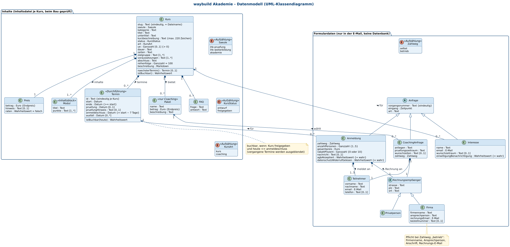
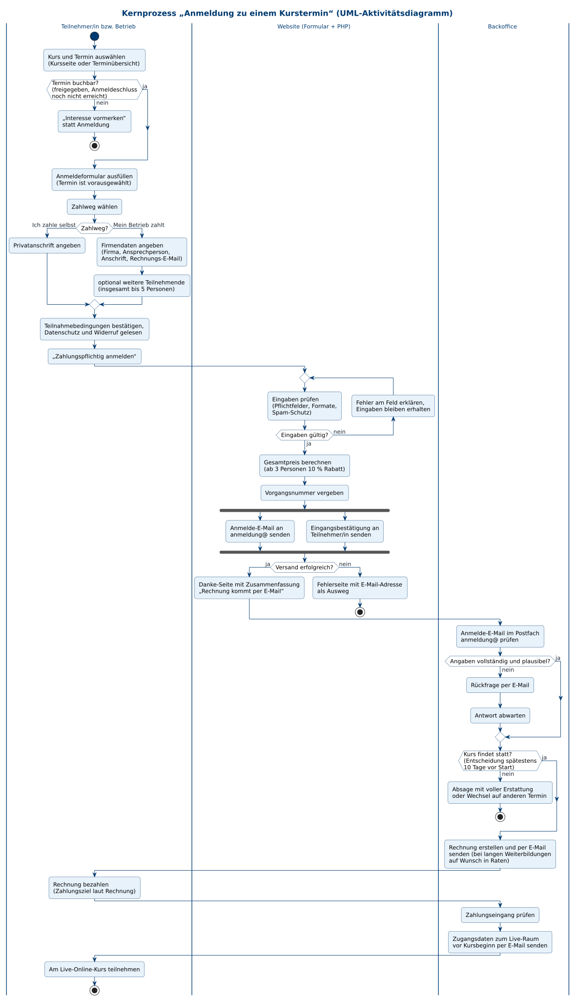
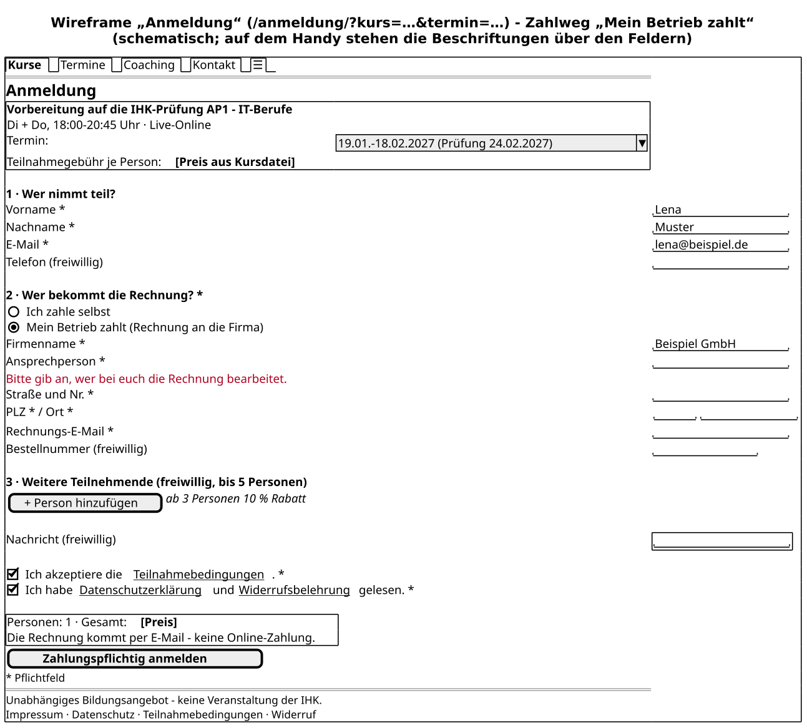

# Spezifikation waybuild Akademie

Phase 1 „Konzeption“ · Stand: 13.11.2026 · Status: **Entwurf zur Freigabe**

Das [Anforderungsdokument](02-anforderungen.md) beschreibt, **was** die Website können muss (US-xx, NFA-xx).
Dieses Dokument legt fest, **womit und nach welchen Regeln** sie es tut: Datenmodell, Geschäftsprozesse, Geschäftsregeln,
Schnittstellen und Oberflächen. Die technische Umsetzung steht im [Architekturdokument](04-architektur.md).

---

## Inhalt

1. [Datenmodell](#1-datenmodell)
2. [Geschäftsprozesse](#2-geschäftsprozesse)
3. [Geschäftsregeln](#3-geschäftsregeln)
4. [Systemschnittstellen](#4-systemschnittstellen)
5. [Benutzerschnittstellen](#5-benutzerschnittstellen)
6. [Offene Punkte](#6-offene-punkte)

---

## 1. Datenmodell

Das Datenmodell hat zwei Teile:

- **Inhalte** – alles, was auf der Website angezeigt wird. Jeder Kurs ist **eine Inhaltsdatei** (`src/content/kurse/<slug>.md`)
  mit festen Feldern; Termine, Preis, Inhaltsblöcke und FAQ gehören zum Kurs. Beim Erzeugen der Website prüft ein Schema
  alle Felder; ein Fehler stoppt die Veröffentlichung (US-21, NFA-17).
- **Formulardaten** – was Besucher eingeben (Anmeldung, Interesse, Coaching-Anfrage). Diese Daten werden **nicht
  gespeichert**, sondern nur als E-Mail an das passende Postfach geschickt (NFA-10, NFA-24).

### 1.1 UML-Klassendiagramm



Quelltext: [`diagramme/2-klassen-datenmodell.puml`](diagramme/2-klassen-datenmodell.puml)

Lesehilfe: Eine Raute (◆) bedeutet „ist fester Bestandteil von“ (ein Termin gehört genau zu einem Kurs).
Ein Pfeil mit leerer Spitze bedeutet „ist eine besondere Art von“ (eine Firma ist eine Art Rechnungsempfänger).
`[0..1]` = freiwillig, `[1..*]` = mindestens ein Eintrag.

### 1.2 Inhalte

| Klasse | Bedeutung | Wichtige Felder | Bezug |
|---|---|---|---|
| **Kurs** | Ein Angebot der Akademie, z. B. „Vorbereitung auf die IHK-Prüfung AP1 – IT-Berufe“. Adresse `/kurse/<slug>/`. | `saeule`, `kategorie`, `titel`, `kurzbeschreibung` (≤ 220 Zeichen), `status` (entwurf/freigegeben), `art` (kurs/coaching), `ue`, `dauer`, `zeiten`, `zielgruppe`, `voraussetzungen`, `abschluss`, `reihenfolge`, Beschreibung als Fließtext | US-03, US-04, US-05, US-21, NFA-16 |
| **Termin** (Durchführung) | Ein konkreter Kursdurchgang mit Start- und Enddatum. | `id` (z. B. `ap1-2027-fruehjahr`), `start`, `ende`, `pruefung` (IHK-Prüfungstag), `pruefungHinweis`, `anmeldeschluss`, `ausfall` (entfallende Tage) | US-07, US-25, US-28 |
| **Preis** | Teilnahmegebühr je Person als Endpreis. | `betrag`, `hinweis` (z. B. „inkl. Lernmaterial“), `raten` (Ratenzahlung möglich ja/nein) | US-03, NFA-21 |
| **Paket** | Nur beim Coaching: buchbare Pakete (z. B. Einzelcoaching, 3er-Paket, Intensivbegleitung, je 60 Minuten). | `name`, `betrag`, `beschreibung` | US-15 |
| **Modul** (Inhaltsblock) | Gliederung der Kursinhalte, z. B. „Netzwerke“ mit Stichpunkten. | `titel`, `punkte` | US-04 |
| **FAQ** | Kursbezogene Frage mit Antwort. | `frage`, `antwort` | US-17 |

Aufzählungen: **Säule** `ihk-pruefung` (IHK-Prüfungsvorbereitung) · `ihk-weiterbildung` (IHK-Weiterbildung) ·
`akademie` (eigene Weiterbildung) – **Status** `entwurf` · `freigegeben` – **Art** `kurs` · `coaching`.

Abgeleitete Werte (werden berechnet, nicht gepflegt):

| Wert | Regel |
|---|---|
| nächster Termin | frühester Termin, dessen Anmeldeschluss noch nicht vorbei ist (GR-11) |
| buchbar | Kurs ist `freigegeben` **und** hat mindestens einen Termin mit `heute ≤ anmeldeschluss` |
| Knopf auf Karte und Kursseite | buchbar → „Anmelden“; sonst → „Interesse vormerken“ (US-14, US-25 AK3); Coaching → „Paket anfragen“ |
| Countdown Startseite | Tage bis zum IHK-Prüfungstag (`pruefung`) des nächsten buchbaren Termins einer Prüfungsvorbereitung |

### 1.3 Formulardaten

| Klasse | Bedeutung | Felder | Bezug |
|---|---|---|---|
| **Anfrage** (abstrakt) | Gemeinsamer Kopf jeder Formular-E-Mail | `vorgangsnummer` (eindeutig, z. B. `A-20261215-7F3K`), `eingang` (Zeitpunkt), `art` | US-24, US-29 |
| **Anmeldung** | Verbindliche, zahlungspflichtige Anmeldung zu einem Termin | `zahlweg`, `anzahlPersonen` (1–5), `gesamtpreis`, `rabattProzent` (0 oder 10), `nachricht`, Bestätigungen | US-10 … US-13 |
| **Teilnehmer** | Eine teilnehmende Person | `vorname`, `nachname`, `email`, `telefon` (nur bei Person 1, freiwillig) | US-10, US-13 |
| **Rechnungsempfänger** (abstrakt) | Wohin die Rechnung geht | `strasse`, `plz`, `ort` | US-11 |
| **Privatperson** | Zahlweg „Ich zahle selbst“; Name kommt von Teilnehmer 1 | – | US-11 |
| **Firma** | Zahlweg „Mein Betrieb zahlt“ | `firmenname`, `ansprechperson`, `rechnungsEmail`, `bestellnummer` (freiwillig) | US-11 |
| **Interesse** | Unverbindliche Vormerkung für einen Kurs ohne buchbaren Termin | `name`, `email`, `kurs`, `wunschzeitraum`, `einwilligungBenachrichtigung` | US-14 |
| **CoachingAnfrage** | Unverbindliche Anfrage eines Coaching-Pakets | `paket`, `anliegen`, `pruefungszeitraum`, `wunschzeiten`, `zahlweg` + Rechnungsempfänger | US-15 |

Die **Kontaktanfrage** (US-16: Name, E-Mail, Nachricht, optional Telefon, Kursbezug, Rückrufwunsch) folgt demselben Muster
und ist im Diagramm aus Platzgründen nicht gezeigt.

Bewusst **nicht** im Modell: Plätze/Belegung und Termin-Status (US-08 – Entscheidung: zunächst keine Plätze-Anzeige,
siehe [TD-03](05-technical-debt.md)), Dozenten (anonym, GR-15), Förderhinweise (US-26 – erst nach Freigabe, siehe TD-09).

---

## 2. Geschäftsprozesse

### 2.1 Übersicht

| Nr. | Prozess | Auslöser | Ergebnis | Beteiligte | Bezug |
|---|---|---|---|---|---|
| P-01 | **Anmeldung zu einem Kurstermin** (Kernprozess) | Besucher klickt „Anmelden“ | Rechnung versandt, Zugangsdaten zum Live-Raum verschickt | Teilnehmer/Betrieb, Website, Backoffice | US-10 … US-13, US-24 |
| P-02 | **Interesse vormerken** | Kurs ohne buchbaren Termin | Interessent wird benachrichtigt, sobald ein Termin feststeht | Interessent, Website, Backoffice, Redaktion | US-14 |
| P-03 | **Kursabsage durch die Akademie** | zu wenige Anmeldungen oder Ausfall der Lehrkraft | Teilnehmende informiert, Erstattung oder Wechsel | Geschäftsführung, Backoffice, Redaktion | GR-08 |
| P-04 | **Kursentwurf freigeben** | neue Kursidee bzw. vorbereiteter Entwurf | Kurs öffentlich buchbar | Redaktion, Geschäftsführung | US-21 … US-23 |

### 2.2 P-01 Anmeldung zu einem Kurstermin (Kernprozess)

Ablauf in drei Bahnen: Teilnehmer/in bzw. Betrieb, Website (Formular im Browser und Prüfung auf dem Server) und Backoffice.



Quelltext: [`diagramme/3-aktivitaet-anmeldung.puml`](diagramme/3-aktivitaet-anmeldung.puml)

Schritte im Backoffice (außerhalb der Website):

1. **Eingang:** Anmelde-E-Mail im Postfach `anmeldung@waybuild-akademie.de` (Betreff z. B. „Anmeldung · AP1 IT-Berufe · 19.01.2027“).
2. **Prüfung:** Angaben vollständig und plausibel? Sonst Rückfrage per E-Mail (Antwort auf die Anmelde-E-Mail geht direkt an die Person).
3. **Durchführung entscheiden:** spätestens 10 Tage vor Start (GR-08); bei Absage weiter mit P-03.
4. **Rechnung** an die Privatperson oder an die Rechnungs-E-Mail der Firma, mit Vorgangsnummer und ggf. Bestellnummer;
   bei langen Weiterbildungen auf Wunsch als Ratenplan (GR-09).
5. **Zahlungseingang** prüfen.
6. **Zugangsdaten zum Live-Raum** vor Kursbeginn per E-Mail an jede teilnehmende Person (nie auf der Website, US-09 AK2).

### 2.3 P-02 Interesse vormerken

1. Besucher öffnet einen Kurs ohne buchbaren Termin und klickt „Interesse vormerken“ (`/interesse/?kurs=<slug>`).
2. Formular mit Name, E-Mail, Kurs (vorausgewählt), optional Wunschzeitraum, ausdrückliche Einwilligung zur Benachrichtigung.
3. E-Mail an `info@` mit Art „Interesse“; Eingangsbestätigung an den Interessenten.
4. Backoffice führt eine Liste je Kurs (zunächst im Postfach bzw. in einer Tabelle, später CRM).
5. Legt die Redaktion einen Termin an, benachrichtigt das Backoffice alle Vorgemerkten per E-Mail. Widerruf der
   Einwilligung jederzeit per E-Mail; danach wird der Eintrag gelöscht.

### 2.4 P-03 Kursabsage durch die Akademie

1. Spätestens **10 Tage vor Start** entscheidet die Geschäftsführung, ob der Termin stattfindet (Mindestzahl ist intern, GR-20).
2. Bei Absage: Backoffice informiert alle Angemeldeten per E-Mail und bietet **Wechsel auf einen anderen Termin** oder
   **volle Erstattung** bereits gezahlter Beträge an (GR-08).
3. Redaktion entfernt den Termin aus der Inhaltsdatei (oder ersetzt ihn durch den Ersatztermin); nach der nächsten
   Veröffentlichung ist er nicht mehr buchbar. Hat der Kurs keinen Termin mehr, zeigt er automatisch „Interesse vormerken“.
4. Fällt nur ein einzelner Kurstag aus, wird er im Feld `ausfall` eingetragen und den Teilnehmenden ein Nachholtermin mitgeteilt.

### 2.5 P-04 Kursentwurf freigeben

1. Redaktion (Team oder KI-Assistent) legt eine neue Inhaltsdatei nach Vorlage an – immer mit `status: entwurf` (GR-10).
2. Die Vorschau zeigt den Entwurf mit gelbem Band „Entwurf – noch nicht freigegeben“; Anmelden ist dort nicht möglich.
3. Fachliche Prüfung (Inhalte, Prüfungsbezug) und Textprüfung gegen die Begriffsliste (NFA-20, NFA-22).
4. Geschäftsführung prüft Inhalt, Dauer, Termine und Preis in der Vorschau.
5. Freigabe: Status auf `freigegeben` ändern; die Änderung wird im Repository mit Datum und freigebender Person festgehalten (US-23).
6. Nächste Veröffentlichung: Der Kurs erscheint im öffentlichen Katalog, in der Terminübersicht und in der Sitemap.

---

## 3. Geschäftsregeln

| ID | Regel | Wo umgesetzt | Bezug |
|---|---|---|---|
| GR-01 | **Anmeldeschluss** ist 7 Tage vor Kursstart (`anmeldeschluss = start − 7 Tage`). Danach ist der Termin nicht mehr buchbar. Beispiel: Start 19.01.2027 → Anmeldeschluss 12.01.2027. | Inhaltsdatei, Schema, Formular-Endpunkt | US-25 |
| GR-02 | Je Anmeldung **1 bis 5 Personen**. Weitere Personen (2–5) können bei Zahlweg „Mein Betrieb zahlt“ hinzugefügt werden. | Formular, Endpunkt | US-13 |
| GR-03 | **Gruppenrabatt:** Ab 3 Personen in einer Anmeldung 10 % auf die gesamte Teilnahmegebühr. Gesamtpreis = Preis × Personen × 0,9 (gerundet auf Cent). | Formular-Zusammenfassung, Endpunkt, Rechnung | US-13 AK2 |
| GR-04 | **Pflichtfelder je Zahlweg:** immer Vorname, Nachname, E-Mail, Zahlweg, Bestätigung der Teilnahmebedingungen und Kenntnisnahme von Datenschutz und Widerruf. „Ich zahle selbst“: zusätzlich Straße, PLZ, Ort. „Mein Betrieb zahlt“: zusätzlich Firmenname, Ansprechperson, Anschrift der Firma, Rechnungs-E-Mail; Bestellnummer freiwillig. Telefon und Nachricht immer freiwillig. | Formular, Endpunkt | US-10 AK2, US-11 |
| GR-05 | **Stornierung durch Teilnehmende:** kostenlos bis 14 Tage vor Kursstart, danach 50 % der Teilnahmegebühr, ab Kursbeginn 100 %. Das gesetzliche Widerrufsrecht für Verbraucher bleibt unberührt. *(Vor Livegang rechtlich prüfen.)* | Teilnahmebedingungen, FAQ | US-20 |
| GR-06 | **Ersatzperson:** Statt der angemeldeten Person darf jederzeit vor Kursbeginn kostenlos eine Ersatzperson teilnehmen (Mitteilung per E-Mail). | Teilnahmebedingungen, FAQ | US-20 |
| GR-07 | **Verbindlichkeit:** Die Anmeldung zu einem Termin ist verbindlich und zahlungspflichtig. Interesse vormerken, Coaching- und Kontaktanfragen sind unverbindlich; beim Coaching kommt der Vertrag erst mit der Terminabstimmung zustande. | Formulartexte, Danke-Seite | US-10, US-14, US-15 AK4 |
| GR-08 | **Absage durch die Akademie:** bis 10 Tage vor Kursstart möglich; Angemeldete erhalten volle Erstattung oder wechseln kostenlos auf einen anderen Termin. | Teilnahmebedingungen, Prozess P-03 | – |
| GR-09 | **Ratenzahlung** bei langen Weiterbildungen (Kursfeld `preis.raten = true`) ohne Aufpreis; Ratenplan steht in der Rechnung. Hinweis auf Kursseite und im Formular. | Inhaltsdatei, Kursseite, Rechnung | – |
| GR-10 | **Entwürfe nur in der Vorschau:** Neue Kurse starten mit `status: entwurf`. Entwürfe erscheinen nur in der Vorschau (gelbes Band, nicht buchbar) und nirgends im Live-Build – weder als Seite noch in Katalog, Terminen, Countdown, Sitemap oder strukturierten Daten. | Build, Tests | US-22, NFA-19 |
| GR-11 | **Vergangene Termine ausblenden:** Termine mit abgelaufenem Anmeldeschluss werden nicht als buchbar gezeigt; die Website wird täglich neu erzeugt. Der Formular-Endpunkt lehnt Anmeldungen zu abgelaufenen Terminen zusätzlich ab. | Build, Endpunkt | US-25 |
| GR-12 | **Preise sind Endpreise** in Euro („inkl. aller Kosten“, inklusive ggf. anfallender Umsatzsteuer). Kein Hinweis „umsatzsteuerfrei“, solange keine Befreiung vorliegt. Die IHK-Prüfungsgebühr ist nie enthalten – das steht bei jedem IHK-Kurs. | Kurskarte, Kursseite, Formular | NFA-21, US-04 AK4 |
| GR-13 | **IHK-Hinweis:** Im Fußbereich jeder Seite und auf allen IHK-bezogenen Kursseiten steht: „Unabhängiges Bildungsangebot der waybuild Akademie – keine Veranstaltung der IHK. Die Prüfung legst du bei deiner zuständigen IHK ab; verbindlich sind deren Termine.“ Keine IHK-Logos, kein „IHK-Kurs“, kein „(IHK)“ bei eigenen Abschlüssen. | Layout, Kursseite | US-19, NFA-20, NFA-22 |
| GR-14 | **Absende-Knopf** der Anmeldung heißt „Zahlungspflichtig anmelden“; direkt darüber steht der Gesamtpreis. Unverbindliche Formulare heißen „Interesse vormerken“, „Paket anfragen“, „Nachricht senden“. | Formular | US-10 AK4 |
| GR-15 | **Lehrende anonym:** keine Namen, Fotos oder Lebensläufe. Erlaubte Formulierungen: „erfahrene IHK-Prüfer und Dozenten mit langjähriger Praxis“, „Dozenten mit IHK-Prüfer-Erfahrung“. Keine Zahlen, Quoten oder Bewertungen ohne Beleg. | alle Texte | US-18 |
| GR-16 | **Wortwahl:** „Teilnahmegebühr“ oder „Kurspreis“ – nie „Prüfungsgebühr“ für eigene Leistungen. Ansprache überall „du“ (klein). Prüfungsvorbereitungen heißen „Vorbereitung auf die IHK-Prüfung …“. | alle Texte | NFA-06, NFA-21 |
| GR-17 | **Förderung** (Aufstiegs-BAföG, Bildungsgutschein) wird nicht beworben, solange sie nicht gesichert und freigegeben ist. | alle Texte | US-26 |
| GR-18 | **Prüfungstermin als Orientierung:** Jede Durchführung einer Prüfungsvorbereitung nennt den zugehörigen schriftlichen Prüfungstag mit dem Hinweis „Verbindlich ist die Einladung deiner IHK“. | Kursseite, Termine | US-28 |
| GR-19 | **Coaching:** Projektantrag, Dokumentation und alle Prüfungsleistungen erstellen die Teilnehmenden selbst; Coaching ist Beratung, Rückmeldung und Training; keine Einflussnahme auf Prüfung oder Bewertung. | Coaching-Seite, Formular | US-15 AK3, US-19 AK3 |
| GR-20 | **Keine Plätze- und Mindestzahl-Angaben:** Mindestteilnehmerzahl und freie Plätze werden nicht öffentlich genannt (kein Plätze-Zähler). | alle Seiten | Entscheidung, TD-03 |
| GR-21 | **Format und Wortwahl (FernUSG):** Alle Kurse sind synchroner Live-Unterricht per Videokonferenz. Aufzeichnungen, abrufbare Mitschnitte und Selbstlern- oder Korrekturleistungen sind nicht Vertragsbestandteil und werden weder angeboten noch beworben. Texte sagen „live“, „gemeinsam“, „in Echtzeit“ – nie „Selbstlernkurs“, „jederzeit abrufbar“ oder „Fernkurs“. | alle Texte, Teilnahmebedingungen | R-01, TD-08 |

**Summe:** 21 Geschäftsregeln (GR-01 bis GR-21).

---

## 4. Systemschnittstellen

| ID | Schnittstelle | Richtung / Technik | Inhalt | Bezug |
|---|---|---|---|---|
| S-01 | **Formular → PHP-Endpunkt** `https://waybuild-akademie.de/api/anmeldung.php` (ALL-INKL) | Browser → Server, HTTPS `POST` (`application/x-www-form-urlencoded`). Mit JavaScript per `fetch` (Antwort JSON), ohne JavaScript als normales Absenden (Antwort Weiterleitung bzw. einfache Fehlerseite). | Formularfelder (Abschnitt 5.4), Formularart (`anmeldung`, `interesse`, `coaching`, `kontakt`), Lockfeld, Zeitstempel | US-10, NFA-05, NFA-13, NFA-14 |
| S-02 | **Antworten des Endpunkts** | Server → Browser | `303` → `/danke/?art=…` (Erfolg) · `422` + Fehlerliste je Feld · `429` zu schnell/zu viele Anfragen · `500` Versand fehlgeschlagen (mit E-Mail-Adresse als Ausweg) | US-12 AK4, NFA-25 |
| S-03 | **Anmelde-E-Mail an `anmeldung@waybuild-akademie.de`** | Server → Postfach, PHP `mail()` über den Mailserver von ALL-INKL | Betreff „<Art> · <Kurs> · <Startdatum>“; Textteil mit allen Angaben in fester Reihenfolge, Rechnungsempfänger deutlich als PRIVAT oder FIRMA gekennzeichnet; am Ende ein maschinenlesbarer JSON-Block mit Vorgangsnummer; `Reply-To` = E-Mail der anmeldenden Person | US-24, US-29 AK1 |
| S-04 | **Eingangsbestätigung an Teilnehmende** | Server → Postfach der Person, `mail()`, Absender `anmeldung@` bzw. `info@` | Zusammenfassung der Angaben, Hinweis „Rechnung kommt per E-Mail, keine Online-Zahlung“, nächste Schritte; kein Zugangslink | US-12 AK3 |
| S-05 | **Postfach-Zuordnung** | – | Anmeldung und Coaching-Anfrage → `anmeldung@`; Interesse und Kontakt → `info@` | US-24 AK3 |
| S-06 | **Terminliste für den Endpunkt** | Build → Server (Datei) | Beim Erzeugen der Website entsteht eine Liste aller buchbaren Termine (Kurs, Termin-ID, Start, Anmeldeschluss, Preis). Der Endpunkt prüft damit Termin und Preis, statt Werte aus dem Formular zu übernehmen. | US-21 AK4, GR-03, GR-11 |
| S-07 | **Weiterleitung top-abschluss.de** | DNS/Webserver ALL-INKL, HTTP `301` | `top-abschluss.de` und `www.top-abschluss.de` (jeder Pfad) → `https://waybuild-akademie.de/pruefungsvorbereitung/` | US-27 |
| S-08 | **Live-Raum / Videokonferenz** | außerhalb der Website | Zugangsdaten verschickt das Backoffice per E-Mail; die Website enthält keine Zugangslinks | US-09 AK2 |
| S-09 | **CRM (später)** | Postfach bzw. Endpunkt → CRM | Übernahme über den JSON-Block der E-Mail oder einen zusätzlichen Versand aus dem Endpunkt – ohne Änderung der Formulare | US-29 |
| S-10 | **Kalenderdatei (Kann)** | Build → statische `.ics`-Datei je Termin | Kursname, Unterrichtsabende, Zeitzone Europe/Berlin, Hinweis „Zugangslink folgt per E-Mail“ | US-09 |

Beispiel JSON-Block (gekürzt, Feldnamen fest):

```json
{
  "vorgang": "A-20261215-7F3K",
  "art": "anmeldung",
  "kurs": "ap1-it-berufe",
  "termin": "ap1-2027-fruehjahr",
  "zahlweg": "betrieb",
  "personen": [{ "vorname": "Lena", "nachname": "Muster", "email": "lena@beispiel.de" }],
  "rechnung": { "firma": "Beispiel GmbH", "ansprechperson": "…", "strasse": "…", "plz": "…", "ort": "…", "email": "…", "bestellnummer": "" },
  "rabattProzent": 0,
  "gesamtpreis": 0.0
}
```

---

## 5. Benutzerschnittstellen

### 5.1 Seitenliste

| Adresse | Seite | Zweck | Bezug |
|---|---|---|---|
| `/` | Start | Kernversprechen, drei Säulen, nächste Starttermine mit Preis, Prüfungs-Countdown, Lernpfad, Ablauf | US-01, US-06 |
| `/kurse/` | Kurskatalog | Alle Kurse als Karten, Filter nach Säule und Kategorie (Filter in der Adresse), Trefferzahl | US-02, US-03 |
| `/kurse/<slug>/` | Kursdetail | Kopf mit Kennzahlen und Knopf, Sprungnavigation, Inhalte, Termine, Preis und Leistungen, Voraussetzungen, Ablauf, FAQ | US-04, US-05, US-28 |
| `/termine/` | Terminübersicht | Alle künftigen Termine aller Kurse, sortiert, nach Säule filterbar | US-07 |
| `/pruefungsvorbereitung/` | Landingpage IHK-Prüfung | Einstieg für Azubis; Ziel der Weiterleitung von top-abschluss.de | US-27 |
| `/coaching/` | Prüfungscoaching | Pakete mit Preis, Ablauf, Hinweis zu Prüfungsleistungen | US-15 |
| `/ueber-uns/` | Über uns | Anbieter, Lehrende allgemein (anonym), Kontaktweg | US-18 |
| `/faq/` | FAQ | Gruppierte Fragen, ausklappbar, ohne JavaScript lesbar | US-17 |
| `/kontakt/` | Kontakt | Kontaktformular, sichtbare E-Mail-Adresse | US-16 |
| `/anmeldung/?kurs=<slug>&termin=<id>` | Anmeldung | Verbindliche Anmeldung zu einem Termin | US-10 … US-13 |
| `/interesse/?kurs=<slug>` | Interesse vormerken | Unverbindliche Vormerkung | US-14 |
| `/danke/?art=<art>` | Danke | Bestätigung mit nächsten Schritten je Formularart | US-12 |
| `/impressum/`, `/datenschutz/`, `/teilnahmebedingungen/`, `/widerruf/` | Rechtsseiten | Pflichtangaben; bis zur Prüfung als Entwurf gekennzeichnet | US-20 |
| `/404` | Fehlerseite | Hilfe mit Links zu Katalog, Terminen, Kontakt | – |

### 5.2 Wireframes (Seitenentwürfe)

Schematische Mobilansicht (360 px). Die Desktopansicht ordnet dieselben Blöcke in mehreren Spalten an.
Nach der Umsetzung werden diese Entwürfe in Phase 3 durch Screenshots der Vorschau ergänzt.

**Startseite**

```
┌──────────────────────────────┐
│ [Logo]               [☰ Menü]│
├──────────────────────────────┤
│ Bestehe deine IHK-Prüfung –  │  H1: Kernversprechen
│ live online, mit Prüfern.    │
│ [ Kurse ansehen ] [Termine]  │  Hauptknöpfe (oberhalb der Kante)
├──────────────────────────────┤
│  Noch 103 Tage bis zur AP1   │  Prüfungs-Countdown
│  [AP1 | AP2]                 │  Umschalter
│  Dein Kurs startet 19.01. →  │
├──────────────────────────────┤
│ ▸ IHK-Prüfungsvorbereitung   │  Drei Säulen mit Einstieg
│ ▸ IHK-Weiterbildungen        │
│ ▸ Eigene Weiterbildungen     │
├──────────────────────────────┤
│ Nächste Starttermine         │  3–5 Karten: Kurs, Datum, Preis
│ ┌──────────────────────────┐ │
│ │ AP1 IT-Berufe · 19.01.   │ │
│ │ 35 UE [Preis] [Anmelden] │ │
│ └──────────────────────────┘ │
├──────────────────────────────┤
│ So läuft es ab: 1 → 2 → 3 → 4│  Lernpfad (Linie zeichnet sich)
├──────────────────────────────┤
│ Fuß: Rechtslinks, IHK-Hinweis│
└──────────────────────────────┘
```

**Kurskatalog**

```
┌──────────────────────────────┐
│ Kurse                        │
│ Säule: (Alle) (Prüfung)      │  Filter-Chips, umbrechend
│        (IHK-WB) (Akademie)   │
│ Kategorie: [ Alle         ▾] │
│ 12 Kurse gefunden            │  wird vom Screenreader angesagt
│ ┌──────────────────────────┐ │
│ │ IHK-Prüfung · IT-Berufe  │ │  Kurskarte
│ │ Vorbereitung auf die IHK-│ │
│ │ Prüfung AP1 – IT-Berufe  │ │
│ │ 35 UE · ca. 5 Wochen     │ │
│ │ [Preis] · ab 19.01.2027  │ │
│ │ [ Details ]  [ Anmelden ]│ │
│ └──────────────────────────┘ │
│ ┌──────────────────────────┐ │
│ │ ▓ ENTWURF (nur Vorschau) │ │  gelbes Band, nicht buchbar
│ │ …                        │ │
│ │ Termin in Planung –      │ │
│ │ [ Interesse vormerken ]  │ │
│ └──────────────────────────┘ │
└──────────────────────────────┘
```

**Kursdetail**

```
┌──────────────────────────────┐
│ IHK-Prüfung · IT-Berufe      │
│ Vorbereitung auf die IHK-    │  H1
│ Prüfung AP1 – IT-Berufe      │
│ 35 UE | ca. 5 Wochen | Live- │  Kennzahlen
│ Online | [Preis]             │
│ [ Termin wählen & anmelden ] │
│ Inhalte · Termine · Preis ·  │  Sprungnavigation
│ Voraussetzungen · FAQ        │
├──────────────────────────────┤
│ Inhalte (Module, ausklappbar)│
│ Termine: 19.01.–18.02.2027   │  je Termin: Zeitraum, Di + Do,
│ Prüfung 24.02. [Anmelden]    │  Uhrzeit, Prüfungstag
│ Preis und Leistungen         │  „IHK-Prüfungsgebühr nicht enthalten“
│ Geeignet für / Hinweis       │
│ Technik: PC, Internet, Headset│
│ FAQ                          │
│ ⓘ Unabhängiges Angebot –     │  IHK-Hinweis
│   keine Veranstaltung der IHK│
├──────────────────────────────┤
│ [ Anmelden ]  (bleibt unten  │  mobil fest am unteren Rand
│               sichtbar)      │
└──────────────────────────────┘
```

**Anmeldeformular** (Salt-Wireframe, Zahlweg „Mein Betrieb zahlt“ mit Fehlermeldung am Feld „Ansprechperson“):



Quelltext: [`diagramme/4-mockup-anmeldung.puml`](diagramme/4-mockup-anmeldung.puml)

Gestaltungsregeln für alle Formulare: eine Spalte, Beschriftung über dem Feld, Pflichtfelder mit `*` und Text
„Pflichtfeld“, Fehlermeldung als Text direkt unter dem Feld (nicht nur rot), nach dem Absenden springt der Fokus auf das
erste fehlerhafte Feld, Knöpfe mindestens 44 × 44 px (NFA-03, NFA-04).

### 5.3 Dialogfluss

```
                ┌───────────── top-abschluss.de (301) ─────────────┐
                ▼                                                   │
 Start (/) ──► Prüfungsvorbereitung ──┐                             │
   │                                  ▼                             │
   ├──────────► Kurskatalog (/kurse/) ──► Kursdetail (/kurse/<slug>/)
   │                                        │          │          │
   └──────────► Termine (/termine/) ────────┤          │          │
                                            ▼          ▼          ▼
                            [Termin buchbar]   [kein Termin]   [Coaching]
                                    │               │              │
                                    ▼               ▼              ▼
                     Anmeldung (/anmeldung/)  Interesse        Coaching-
                       ?kurs=…&termin=…      (/interesse/)     Anfrage
                                    │               │              │
                        Fehler? ◄───┤               │              │
                        (am Feld,   │               │              │
                        Eingaben    ▼               ▼              ▼
                        bleiben)  Danke (/danke/?art=anmeldung | interesse | coaching)
                                    │
                                    ▼
                        E-Mail: Eingangsbestätigung → später Rechnung → Zugangsdaten

 Von jeder Seite: Kopf → Kontakt (/kontakt/) · Fuß → Rechtsseiten, FAQ
```

Regeln für den Dialog:

- Jede Kurskarte und jede Terminzeile führt mit **einem Klick** in das Formular; Kurs und Termin sind vorausgewählt (US-07 AK4).
- Fehlt oder stimmt ein Parameter nicht (z. B. Termin abgelaufen), zeigt das Formular eine Auswahl der buchbaren Termine
  des Kurses bzw. einen Hinweis mit Link zu „Interesse vormerken“.
- Kontakt ist von jeder Seite in höchstens zwei Klicks erreichbar (US-16 AK1).
- Die Danke-Seite nennt je Art die nächsten Schritte und die übliche Antwortzeit (US-12, US-16 AK2).

### 5.4 Eingabevalidierung

Die Prüfung läuft zweimal mit denselben Regeln: im Browser (sofortige Rückmeldung) und auf dem Server (verbindlich, NFA-14).
In allen einzeiligen Feldern werden Zeilenumbrüche entfernt bzw. abgelehnt (Schutz gegen eingeschleuste Mail-Kopfzeilen);
führende und folgende Leerzeichen werden entfernt.

**Anmeldung**

| Feld | Pflicht | Regel | Fehlermeldung |
|---|---|---|---|
| Termin (`termin`) | ja | muss ein buchbarer Termin des Kurses sein (GR-11, S-06) | „Bitte wähle einen Termin aus.“ / „Für diesen Termin ist die Anmeldung leider geschlossen. Wähle einen anderen Termin oder merke dein Interesse vor.“ |
| Vorname | ja | 1–60 Zeichen, keine Ziffern-only-Eingabe | „Bitte gib deinen Vornamen ein.“ |
| Nachname | ja | 1–60 Zeichen | „Bitte gib deinen Nachnamen ein.“ |
| E-Mail | ja | gültiges Format, max. 254 Zeichen | „Bitte gib eine gültige E-Mail-Adresse ein, z. B. name@beispiel.de.“ |
| Telefon | nein | wenn ausgefüllt: 6–30 Zeichen aus Ziffern, Leerzeichen, `+ / - ( )` | „Bitte prüfe deine Telefonnummer – erlaubt sind Ziffern, Leerzeichen und + / -.“ |
| Zahlweg | ja | genau `selbst` oder `betrieb` | „Bitte wähle aus, wer die Rechnung bekommt.“ |
| Straße und Nr. | ja | 3–100 Zeichen | „Bitte gib Straße und Hausnummer ein.“ |
| PLZ | ja | 4–10 Zeichen, Ziffern/Buchstaben/Leerzeichen (auch Österreich, Schweiz) | „Bitte gib eine gültige Postleitzahl ein.“ |
| Ort | ja | 2–60 Zeichen | „Bitte gib deinen Ort ein.“ |
| Firmenname | bei „betrieb“ | 2–120 Zeichen | „Bitte gib den Namen deines Betriebs ein.“ |
| Ansprechperson | bei „betrieb“ | 2–100 Zeichen | „Bitte gib an, wer bei euch die Rechnung bearbeitet.“ |
| Rechnungs-E-Mail | bei „betrieb“ | gültiges Format | „Bitte gib die E-Mail-Adresse für die Rechnung ein.“ |
| Bestellnummer | nein | max. 50 Zeichen | „Die Bestellnummer darf höchstens 50 Zeichen lang sein.“ |
| Weitere Teilnehmende | nein | insgesamt höchstens 5 Personen; je angelegter Person Vorname, Nachname, E-Mail Pflicht; keine doppelten E-Mail-Adressen | „Bitte ergänze Vorname, Nachname und E-Mail für Person 2.“ / „Pro Anmeldung sind höchstens 5 Personen möglich.“ / „Diese E-Mail-Adresse ist schon eingetragen.“ |
| Nachricht | nein | max. 2.000 Zeichen | „Deine Nachricht ist zu lang – bitte kürze sie auf 2.000 Zeichen.“ |
| Teilnahmebedingungen | ja | Häkchen gesetzt | „Bitte bestätige die Teilnahmebedingungen.“ |
| Datenschutz und Widerruf | ja | Häkchen gesetzt | „Bitte bestätige, dass du Datenschutzerklärung und Widerrufsbelehrung gelesen hast.“ |
| Lockfeld (unsichtbar) | – | muss leer sein; sonst stiller Abbruch ohne Versand | – (keine sichtbare Meldung) |
| Zeitstempel (unsichtbar) | – | Absenden frühestens 3 Sekunden nach dem Laden (nur wenn per JavaScript gesetzt) | „Das ging sehr schnell – bitte versuche es in einer Minute erneut.“ |

**Interesse vormerken**

| Feld | Pflicht | Regel | Fehlermeldung |
|---|---|---|---|
| Name | ja | 2–100 Zeichen | „Bitte gib deinen Namen ein.“ |
| E-Mail | ja | gültiges Format | „Bitte gib eine gültige E-Mail-Adresse ein, z. B. name@beispiel.de.“ |
| Kurs | ja | existierender Kurs | „Bitte wähle einen Kurs aus.“ |
| Wunschzeitraum | nein | max. 100 Zeichen | „Bitte fasse deinen Wunschzeitraum kürzer (höchstens 100 Zeichen).“ |
| Einwilligung Benachrichtigung | ja | Häkchen gesetzt, nicht vorausgewählt | „Bitte bestätige, dass wir dich per E-Mail benachrichtigen dürfen.“ |

**Coaching-Anfrage** und **Kontakt** verwenden dieselben Regeln für Name, E-Mail und Telefon, die Coaching-Anfrage zusätzlich für Zahlweg und Rechnungsfelder;
zusätzlich Pflicht: Paket und Anliegen (Coaching, „Bitte wähle ein Paket aus.“ / „Beschreib kurz, wobei wir dir helfen sollen.“)
bzw. Nachricht (Kontakt, 10–2.000 Zeichen, „Bitte schreib uns kurz, worum es geht.“).

---

## 6. Offene Punkte

Aus den offenen Fragen des Anforderungsdokuments sind entschieden: Eingangsbestätigung (ja), Formular-Versand (PHP auf
ALL-INKL), bis 5 Personen mit 10 % ab 3 Personen, Pflichtangaben Betrieb, Absage- und Stornoregeln, Anmeldeschluss,
Ratenzahlung (ja), Plätze-Anzeige (zunächst nicht), Vertrauensaussagen (nur „Dozenten mit IHK-Prüfer-Erfahrung“),
Reichweitenmessung (zunächst keine), Weiterleitung top-abschluss.de (auf die Prüfungsvorbereitung).

Noch offen:

1. Rechtliche Prüfung von GR-05 bis GR-08, der Button-Beschriftung (GR-14), der Widerrufsfunktion und der Einstufung der Kurse als synchroner Live-Unterricht (GR-21, Risiko R-01).
2. Umsatzsteuerliche Behandlung (Risiko R-03) – bestimmt nur die Formulierung des Preishinweises, nicht das Datenmodell.
3. Dürfen auch Selbstzahler weitere Personen anmelden (GR-02)? Vorschlag: nein, nur bei Zahlweg „Betrieb“.
4. Umgang mit einem Kursbeginn innerhalb der Widerrufsfrist (Anmeldung weniger als 14 Tage vor Start) – Text und ggf.
   zusätzliche Bestätigung im Formular nach Rechtsprüfung.
5. Verbindliche IHK-Prüfungstermine 2027 je zuständiger IHK bestätigen (Risiko R-09).
