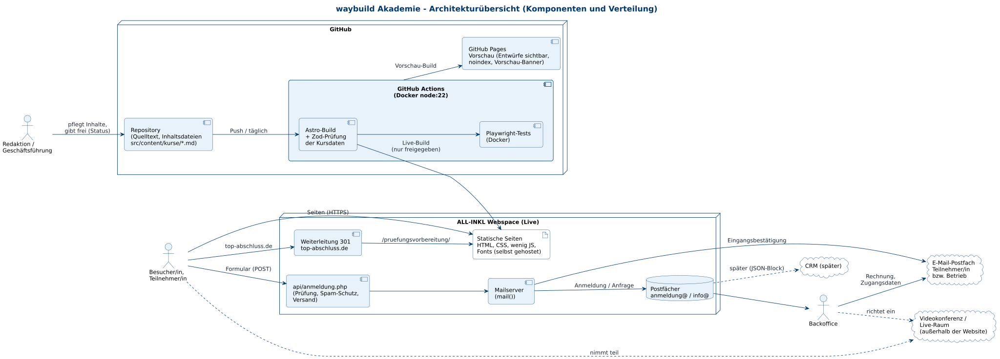
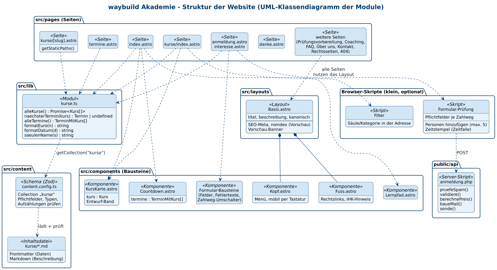
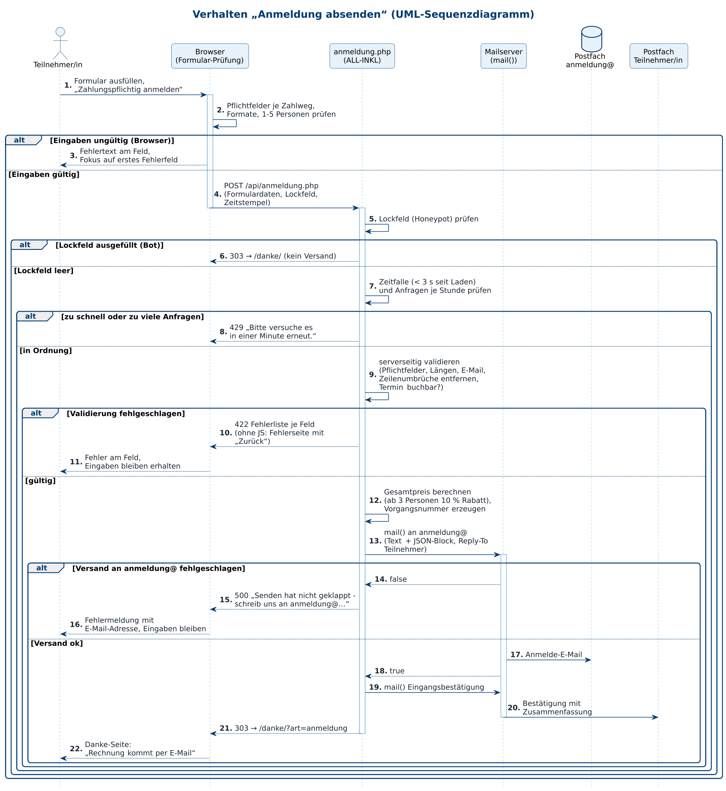

# Architektur waybuild Akademie

Phase 2 „Erarbeitung“ · Stand: 13.11.2026 · Status: **Entwurf**

Dieses Dokument beschreibt, **wie** die Website technisch aufgebaut ist: welche Technologien wir einsetzen und warum,
wie die Teile zusammenspielen (Architekturübersicht), wie der Code gegliedert ist (Struktur) und was beim Absenden einer
Anmeldung passiert (Verhalten). Grundlage sind das [Anforderungsdokument](02-anforderungen.md) und die
[Spezifikation](03-spezifikation.md).

---

## Inhalt

1. [Technologien und Begründung](#1-technologien-und-begründung)
2. [Architekturübersicht](#2-architekturübersicht)
3. [Struktur](#3-struktur)
4. [Verhalten: Anmeldung absenden](#4-verhalten-anmeldung-absenden)
5. [Querschnittsthemen](#5-querschnittsthemen)

---

## 1. Technologien und Begründung

### 1.1 Überblick

| Bereich | Technologie | Begründung | Bezug |
|---|---|---|---|
| Seitengenerator | **Astro 5**, rein statische Ausgabe | Erzeugt fertige HTML-Seiten ohne Datenbank und ohne Server-Programm zur Auslieferung – schnell, sicher, günstig. Standardmäßig kein JavaScript im Browser; nur kleine Skripte dort, wo sie nötig sind (Filter, Formular). | NFA-01, NFA-02, NFA-24 |
| Inhalte | **Astro Content Collections** mit **Zod-Schema** (`src/content.config.ts`) | Jeder Kurs ist eine Markdown-Datei mit Datenkopf. Das Schema prüft beim Bau Pflichtfelder, Datentypen und Aufzählungen; ein Fehler stoppt die Veröffentlichung mit verständlicher Meldung. Eine Datenquelle für Karte, Kursseite, Termine, Formular und strukturierte Daten. | US-21, NFA-17, NFA-18 |
| Gestaltung | **Tailwind CSS 4** (`@tailwindcss/vite`) + **daisyUI 5** als **einzige** UI-Bibliothek | daisyUI ist ein reines CSS-Plugin für Tailwind: fertige, einheitliche Bausteine (Knöpfe, Karten, Formularfelder, Akkordeon, Hinweise) ohne JavaScript-Abhängigkeit, mit eigenem Theme „akademie“ in den Markenfarben. Läuft direkt in Astro-Komponenten. | NFA-02, NFA-03, NFA-18 |
| Schriften | **Fraunces Variable** (Überschriften) und **Inter Variable** (Text) über `@fontsource-variable/*`, **selbst gehostet** | Keine Verbindung zu Google Fonts oder anderen Fremd-Domains; variable Schriften halten die Datenmenge klein. | NFA-08, NFA-09 |
| Formular-Versand | **PHP-Skript** `public/api/anmeldung.php` auf dem **ALL-INKL-Webspace**, Versand mit `mail()` | ALL-INKL bietet PHP und Postfächer ohne Zusatzkosten; kein externer Formulardienst, keine Datenübertragung an Dritte, keine Datenbank. Prüft alle Eingaben serverseitig und schützt vor Spam. | US-10, US-12, US-24, NFA-10, NFA-13, NFA-14 |
| Browser-Skripte | **Vanilla JavaScript/TypeScript** (ohne Framework) | Formularprüfung, Zahlweg-Umschaltung, Personen hinzufügen, Katalogfilter. Ohne JavaScript bleibt alles nutzbar (normales Absenden, alle Kurse sichtbar). | NFA-05 |
| Vorschau und Bau | **GitHub Actions** (Build in Docker `node:22`) + **GitHub Pages** | Jeder Push erzeugt die Vorschau mit Entwürfen (`PUBLIC_PREVIEW=true`, `noindex`, Vorschau-Banner) und ein Live-Paket ohne Entwürfe. Täglicher geplanter Lauf blendet abgelaufene Termine aus. | US-22, US-25, NFA-19 |
| Live-Hosting | **ALL-INKL-Webspace** (wie bei bestehenden waybuild-Seiten) | HTTPS mit Zertifikat, PHP für das Formular, Postfächer `anmeldung@` und `info@`, Domain-Weiterleitung für top-abschluss.de. | US-27, NFA-11, NFA-24 |
| Tests | **Playwright** im Docker-Image `mcr.microsoft.com/playwright:v1.48.2-jammy` | End-to-End-Tests in echten Browsern: Seiten laden, kein seitliches Scrollen 320–1440 px, Tastaturbedienung, Formularregeln, keine Entwürfe im Live-Build. | NFA-03, NFA-04, NFA-19 |
| Diagramme | **PlantUML** (Docker `plantuml/plantuml:1.2024.8`) | Diagramme als Text im Repository, versionierbar, einheitlicher Stil (`docs/diagramme/_stil.iuml`). | – |

Umgebungsvariablen (wie bei der waybuild-Website): `SITE` (Basis-Adresse), `BASE` (`/waybuild_Akademie` in der
Vorschau, `/` live), `PUBLIC_PREVIEW` (`true` nur in der Vorschau).

### 1.2 Warum nur daisyUI – und nicht coss, AlignUI, HeroUI oder Ant Design?

Zur Auswahl standen mehrere UI-Bibliotheken. Wir setzen **nur daisyUI** als Laufzeit-Bibliothek ein. Die anderen dienen
als **Gestaltungsvorbild** (Abstände, Formularmuster, Karten- und Tabellenlayouts, Zustände von Feldern), werden aber
nicht eingebunden.

| Bibliothek | Art | Warum nicht als Laufzeit-Bibliothek |
|---|---|---|
| **daisyUI 5** | reines CSS-Plugin für Tailwind | **gewählt:** kein JavaScript, kein Framework nötig, Theme in Markenfarben, barrierearme Grundbausteine |
| **coss UI** | React-Komponenten auf Tailwind-Basis | braucht **React** im Browser (Astro-„Inseln“); mehr JavaScript je Seite, gefährdet das Budget von < 50 KB JS (NFA-02) |
| **AlignUI** | React-Komponenten und Vorlagen | **React-Abhängigkeit**; die umfangreichen Vorlagen sind Teil eines **kostenpflichtigen Pro-Pakets** – laufende Lizenzfrage für eine öffentliche Website |
| **HeroUI** | React-Komponenten mit Animationsbibliothek | **React + Animationsbibliothek**, deutlich höheres JS-Gewicht; Animationen müssten für „reduzierte Bewegung“ zusätzlich abgesichert werden |
| **Ant Design** | großes React-Komponentensystem | **sehr hohes JS- und CSS-Gewicht**, eigenes Design-System mit „Verwaltungs-Optik“, das sich schwer an die Marke anpassen lässt |

Gründe gegen eine Mischung mehrerer Bibliotheken:

1. **JavaScript-Gewicht:** Jede React-Bibliothek lädt React selbst plus Komponenten-Code. Für eine statische
   Informationsseite mit wenigen Formularen ist das unnötig und verschlechtert Ladezeit und Lighthouse-Wert (NFA-01, NFA-02).
2. **Uneinheitliches Design:** Unterschiedliche Bibliotheken bringen eigene Abstände, Rundungen, Fokus-Rahmen und
   Farblogiken mit. Ein einheitliches Erscheinungsbild und gleiches Verhalten (z. B. Fehlermeldungen) wären nur mit hohem
   Anpassungsaufwand erreichbar (NFA-18).
3. **Wartung:** Eine Bibliothek bedeutet eine Update-Linie, ein Theme, eine Dokumentation.
4. **Kosten und Lizenz:** Kein kostenpflichtiges Pro-Paket, keine Lizenzfragen für Vorlagen (NFA-23).
5. **Ohne JavaScript nutzbar:** daisyUI-Bausteine funktionieren auch, wenn JavaScript ausgeschaltet ist (NFA-05).

---

## 2. Architekturübersicht

Quelltext: [`diagramme/5-architektur.puml`](diagramme/5-architektur.puml)

**Bausteine und Wege:**

1. **Pflege:** Redaktion und Geschäftsführung ändern Inhaltsdateien im GitHub-Repository; die Freigabe eines Kurses ist
   eine Statusänderung in der Datei (US-21, US-23).
2. **Bau:** GitHub Actions erzeugt bei jedem Push und täglich einmal die Website. Das Zod-Schema prüft die Kursdaten,
   Playwright testet die Seiten. Es entstehen zwei Ausgaben aus demselben Stand (NFA-19):
   - **Vorschau** auf GitHub Pages – mit Entwürfen, gesperrt für Suchmaschinen (`noindex`, `robots.txt` `Disallow: /`),
     Formulare im Demo-Modus ohne Versand;
   - **Live-Paket** für ALL-INKL – nur freigegebene Kurse, mit Formular-Endpunkt und Terminliste für den Endpunkt (S-06).
3. **Auslieferung:** Besucher rufen die statischen Seiten über HTTPS ab. `top-abschluss.de` leitet per 301 auf
   `/pruefungsvorbereitung/` (S-07).
4. **Formular:** Das Formular sendet an `api/anmeldung.php`. Das Skript prüft, berechnet den Preis aus der Terminliste und
   übergibt zwei E-Mails an den Mailserver von ALL-INKL: an das Akademie-Postfach und als Eingangsbestätigung an die
   anmeldende Person (S-01 … S-05).
5. **Backoffice:** bearbeitet die Anmeldung im Postfach, schickt Rechnung und Zugangsdaten per E-Mail und richtet den
   Live-Raum ein – alles außerhalb der Website (S-08).
6. **Später:** Ein CRM übernimmt die Daten über den JSON-Block der E-Mail (S-09).

**Verteilung:**

| Umgebung | Ort | Inhalt | Zugriff |
|---|---|---|---|
| Entwicklung | lokal / Arbeitskopie, Node nur per Docker | Quelltext, Tests | Team |
| Vorschau | `https://cansi798.github.io/waybuild_Akademie/` | Build mit Entwürfen, Demo-Formular | nicht verlinkt, `noindex` |
| Live | `https://waybuild-akademie.de` (ALL-INKL) | Build ohne Entwürfe, PHP-Endpunkt | öffentlich |

---

## 3. Struktur

Das Klassendiagramm zeigt die Module der Website und ihre Abhängigkeiten. Astro-Dateien sind hier als „Klassen“
dargestellt; ein gestrichelter Pfeil heißt „verwendet“, eine Raute „ist fester Bestandteil von“.

Quelltext: [`diagramme/6-struktur.puml`](diagramme/6-struktur.puml)

| Schicht | Module | Aufgabe |
|---|---|---|
| **Inhalte** | `src/content/kurse/*.md`, `src/content.config.ts` | Kursdaten und Schema (Datenmodell siehe [Spezifikation, Abschnitt 1](03-spezifikation.md#1-datenmodell)) |
| **Logik** | `src/lib/kurse.ts` | einzige Stelle, die Kurse lädt und aufbereitet: `alleKurse()` (blendet Entwürfe außerhalb der Vorschau aus), `naechsterTermin(kurs)`, `alleTermine()` (sortiert, nur künftige), `formatEuro(n)`, `formatDatum(d)`, `saeulenName(s)` |
| **Layout** | `src/layouts/Basis.astro` | Seitenrahmen: SEO-Angaben, kanonische Adresse, `noindex` und Vorschau-Banner in der Vorschau, Kopf und Fuß |
| **Bausteine** | `src/components/` – `Kopf`, `Fuss` (Rechtslinks, IHK-Hinweis), `Countdown`, `Lernpfad`, `KursKarte` (mit Entwurf-Band), Formular-Bausteine | wiederverwendbare Teile; erhalten Daten nur über Parameter |
| **Seiten** | `src/pages/` – Start, Katalog, `kurse/[slug]` (eine Vorlage für alle Kurse), Termine, Formulare, Danke, weitere Seiten | setzen Bausteine zusammen; Kursseiten entstehen automatisch je Inhaltsdatei |
| **Browser-Skripte** | Filter, Formular-Prüfung | kleine Verbesserungen ohne Framework; Seiten funktionieren auch ohne |
| **Server** | `public/api/anmeldung.php` | Spam-Schutz, Validierung, Preisberechnung, Mail-Aufbau, Versand |

Regeln für die Struktur:

- Seiten greifen **nie direkt** auf die Inhaltsdateien zu, sondern immer über `src/lib/kurse.ts`. So gilt die
  Entwurfsregel (GR-10) und die Terminregel (GR-11) überall gleich.
- Bausteine kennen keine Seiten; Daten fließen nur von oben nach unten.
- Texte mit Rechtsbezug (IHK-Hinweis, Preis-Hinweise) stehen an **einer** Stelle und werden eingebunden, nicht kopiert.

---

## 4. Verhalten: Anmeldung absenden

Das Sequenzdiagramm zeigt den zeitlichen Ablauf beim Absenden einer Anmeldung mit allen Fehlerpfaden.

Quelltext: [`diagramme/7-sequenz-anmeldung.puml`](diagramme/7-sequenz-anmeldung.puml)

| Schritt | Was passiert | Fehlerpfad |
|---|---|---|
| 1–3 | Der Browser prüft Pflichtfelder je Zahlweg, Formate und die Personenzahl. | Fehlertext am Feld, Fokus auf erstes Fehlerfeld, nichts wird gesendet. |
| 4 | `POST` an `/api/anmeldung.php` mit Formulardaten, unsichtbarem Lockfeld und Zeitstempel. Mit JavaScript per `fetch`, ohne JavaScript als normales Absenden. | – |
| 5–6 | **Lockfeld (Honeypot):** ist es ausgefüllt, handelt es sich fast sicher um ein Programm. | Antwort wie bei Erfolg (`303` → `/danke/`), aber **kein Versand** – Bots bekommen keinen Hinweis. |
| 7–8 | **Zeitfalle und Mengenbegrenzung:** Absenden weniger als 3 Sekunden nach dem Laden oder zu viele Anfragen von derselben Adresse in einer Stunde. | `429` mit Bitte, es gleich noch einmal zu versuchen. |
| 9–11 | **Serverseitige Validierung** mit denselben Regeln wie im Browser ([Spezifikation 5.4](03-spezifikation.md#54-eingabevalidierung)), Entfernen von Zeilenumbrüchen in Kopfzeilen-Feldern, Prüfung des Termins gegen die Terminliste (buchbar?). | `422` mit Fehlerliste je Feld; ohne JavaScript eine einfache Fehlerseite mit „Zurück“ – die Eingaben bleiben im Browser erhalten. |
| 12 | Gesamtpreis aus der Terminliste (nicht aus dem Formular) berechnen, ab 3 Personen 10 % Rabatt; Vorgangsnummer erzeugen. | – |
| 13–18 | Anmelde-E-Mail an `anmeldung@` (Textteil + JSON-Block, `Reply-To` = anmeldende Person). | Gibt `mail()` einen Fehler zurück: `500` mit verständlicher Meldung und der E-Mail-Adresse als Ausweg (US-12 AK4, NFA-25). |
| 19–20 | Eingangsbestätigung an die anmeldende Person. | Schlägt nur die Bestätigung fehl, gilt die Anmeldung trotzdem als eingegangen (Backoffice hat sie); die Danke-Seite erscheint. |
| 21–22 | `303` → `/danke/?art=anmeldung`; Danke-Seite mit Zusammenfassung und „Die Rechnung kommt per E-Mail“. | – |

In der **Vorschau** (GitHub Pages) gibt es kein PHP: Das Formular läuft dort im **Demo-Modus** – die Browser-Prüfung ist
aktiv, statt des Versands erscheint direkt die Danke-Seite mit dem Hinweis „Vorschau – es wurde nichts gesendet“.

---

## 5. Querschnittsthemen

| Thema | Umsetzung | Bezug |
|---|---|---|
| **Sicherheit** | Nur HTTPS mit HSTS; Sicherheits-Header (Content-Security-Policy ohne Fremd-Domains, `X-Content-Type-Options`, `Referrer-Policy`, `Permissions-Policy`) über `.htaccess` auf ALL-INKL; serverseitige Validierung; Schutz gegen eingeschleuste Mail-Kopfzeilen; keine Geheimnisse im Repository (Repo ist öffentlich). | NFA-11, NFA-12, NFA-14 |
| **Datenschutz** | Keine Cookies, keine Tracker, keine externen Schriften oder CDNs; Formulardaten nur per E-Mail, keine Datenbank; die Mengenbegrenzung speichert höchstens kurzzeitig einen nicht rückrechenbaren Wert der Absender-Adresse. | NFA-08 … NFA-10 |
| **Barrierefreiheit** | Semantisches HTML, sichtbarer Fokus, Kontraste nach WCAG 2.2 AA, Fehler als Text, „reduzierte Bewegung“ für Lernpfad-Animation, Knöpfe ≥ 44 × 44 px. | NFA-03, NFA-04 |
| **Leistung** | Statische Seiten, kaum JavaScript, selbst gehostete variable Schriften, optimierte Bilder; Budget: Startseite < 500 KB, JS < 50 KB je Seite. | NFA-01, NFA-02 |
| **Auffindbarkeit** | Eigene Titel, Beschreibung und kanonische Adresse je Seite; `sitemap.xml`; strukturierte Daten `Course`/`CourseInstance`/`Event` aus denselben Kursdaten; Vorschau `noindex`. | NFA-15, NFA-16 |
| **Betrieb** | Jede Veröffentlichung ist über das Repository auf einen früheren Stand zurücksetzbar; monatliche Testanmeldung; täglicher Neubau. | NFA-25, US-25 |

Bewusst aufgeschobene technische Punkte (z. B. `mail()` statt Versandbibliothek, kein CRM-Anschluss) stehen im
[Technical-Debt-Dokument](05-technical-debt.md).
